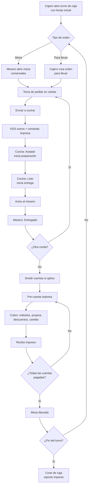
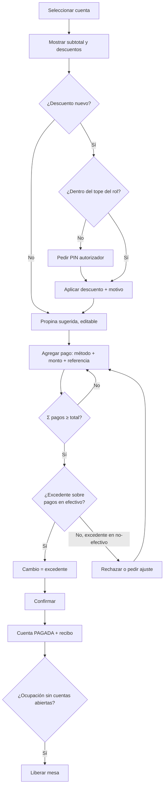
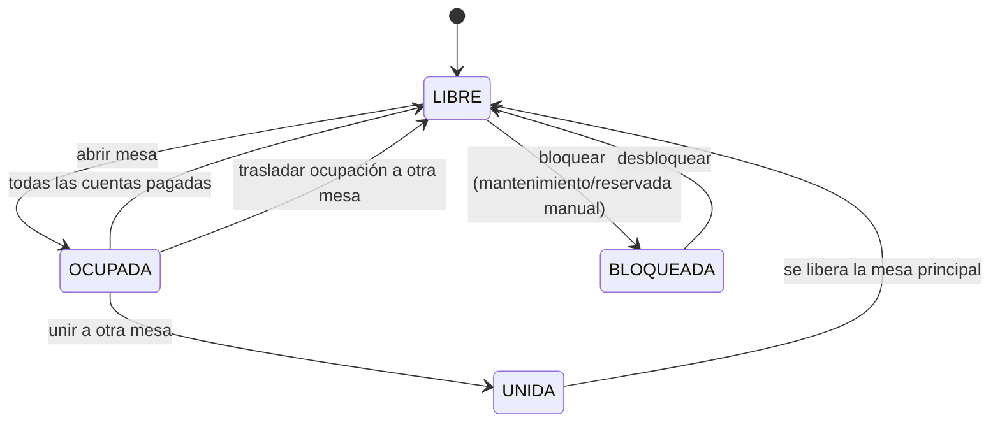
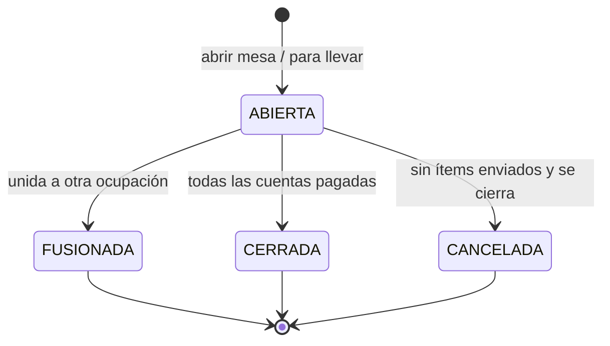
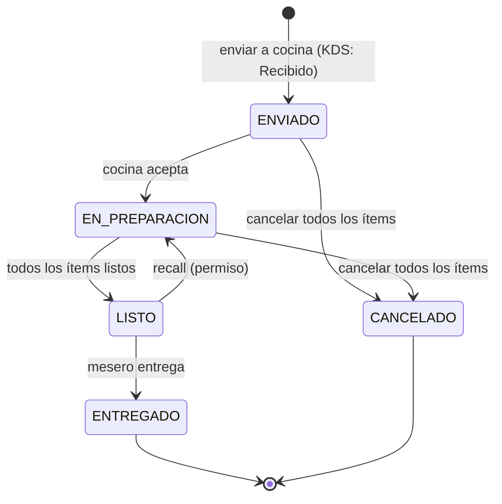
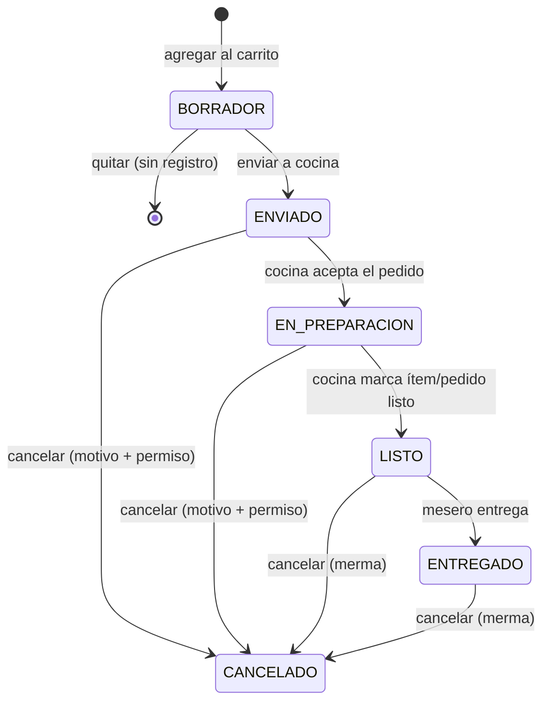
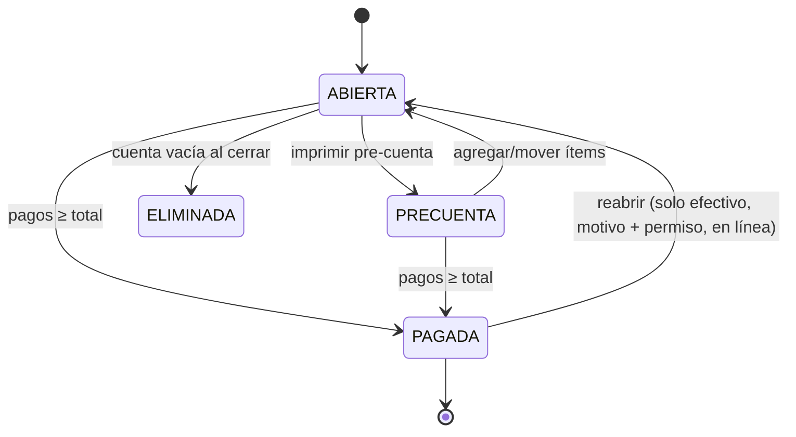
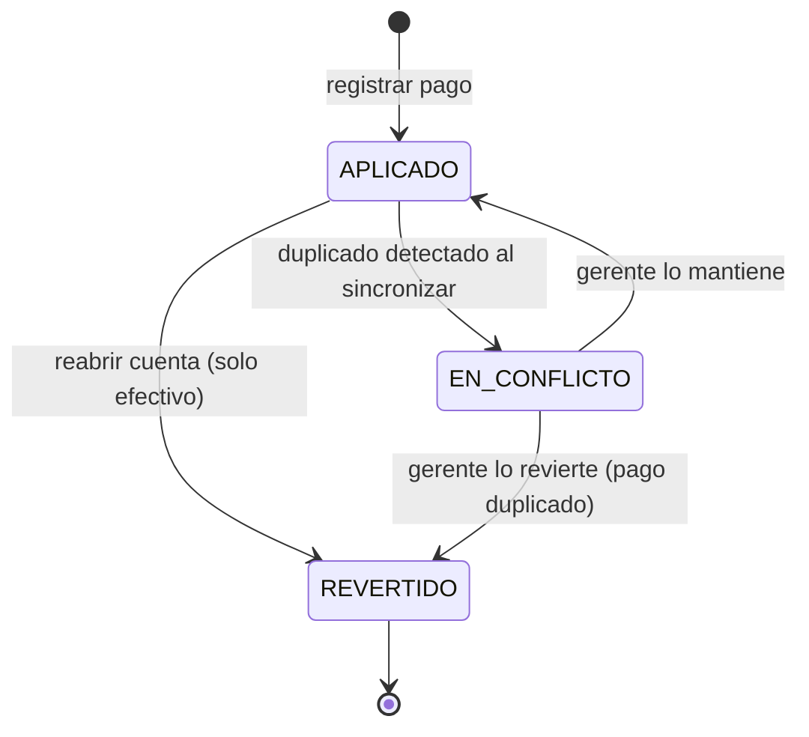
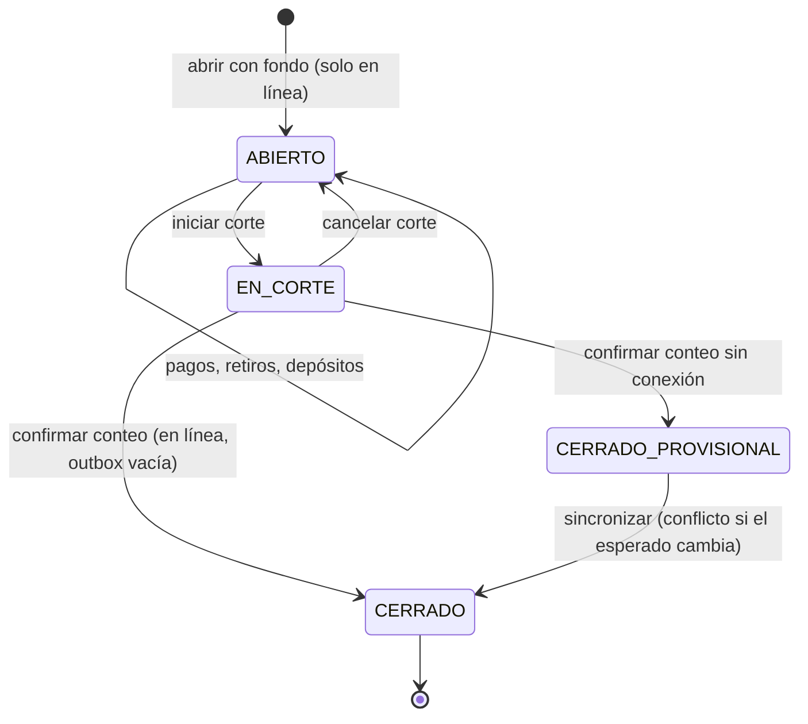
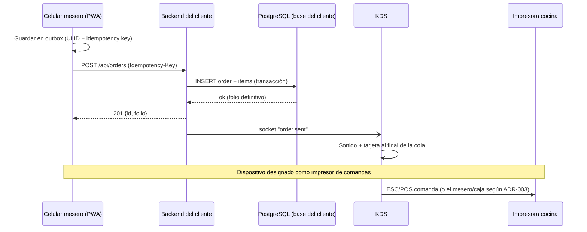

# 05 — Flujos del proceso operativo y diagramas de estados

> ⚠️ **IMPORTANTE — REGLA DEL PROYECTO:** No se escribe ninguna línea de código hasta que esta documentación esté terminada y aprobada. La documentación vive en `Docs/` en formato `.md` y **se actualiza cada vez que se hace un cambio**. Registra cada cambio en el [Control de cambios](README.md#control-de-cambios).

## 1. Flujo general del servicio

## 2. Pasos del flujo operativo

### Paso 1 — Apertura de caja / turno
| Aspecto | Detalle |
|---|---|
| Actor | Cajero (o gerente) con `cash.open_shift` |
| Pantalla | Caja › Abrir turno |
| Entradas | Caja (dispositivo), fondo inicial, observación. El fondo depende de la configuración de la caja (PA-024): **fijo** = el sistema escribe el monto configurado; **variable** = el cajero lo escribe (se sugiere lo que quedó en el corte anterior) |
| Estados | Turno: — → `ABIERTO` |
| Reglas | Un solo turno `ABIERTO` por caja. Se puede operar mesas sin turno, pero **no** cobrar en efectivo. |
| Errores | Turno ya abierto (`409 SHIFT_ALREADY_OPEN`). **Sin conexión no se puede abrir turno** (PA-042): el botón muestra "Requiere conexión". |

### Paso 2 — Abrir mesa u orden para llevar
| Aspecto | Detalle |
|---|---|
| Actor | Mesero / cajero con `table.open` |
| Pantalla | Mesas (lista o mapa por zona) · botón "Para llevar" |
| Entradas | Mesa, comensales (1–99), mesero (por defecto, quien abre). Para llevar: nombre y teléfono opcionales |
| Estados | Mesa `LIBRE` → `OCUPADA`; Ocupación → `ABIERTA`; se crea Cuenta 1 `ABIERTA` |
| Reglas | Una mesa solo tiene una ocupación abierta. El tipo de orden sale del catálogo (`MESA`, `PARA_LLEVAR`). No existe delivery. |
| Errores | Mesa ya ocupada (`409 TABLE_OCCUPIED`), mesa bloqueada, comensales fuera de rango. Offline: el dispositivo que abre la mesa queda "a cargo" de ella. |

### Paso 3 — Toma de pedido (mobile first)
| Aspecto | Detalle |
|---|---|
| Actor | Mesero |
| Pantalla | Mesa › Pedido: categorías (chips horizontales), buscador, tarjetas de producto, hoja inferior de modificadores, carrito |
| Entradas | Producto, cantidad, modificadores, nota libre (máx. 140 caracteres), cuenta destino (por defecto la cuenta activa) |
| Estados | Ítem `BORRADOR` (solo en el dispositivo, IndexedDB) |
| Reglas | Validar mínimos/máximos de modificadores. Precio de línea = (precio producto + Σ modificadores) × cantidad. Productos agotados no se pueden agregar. Borrador persistente local. Ítems iguales (mismo producto, mismos modificadores y nota) se agrupan sumando cantidad. |
| Errores | Producto agotado o desactivado mientras se armaba el borrador → aviso al enviar. |

### Paso 4 — Envío a cocina
| Aspecto | Detalle |
|---|---|
| Actor | Mesero |
| Pantalla | Carrito › "Enviar a cocina" |
| Salidas | Pedido (ronda) con folio; evento `order.sent` al KDS (sonido); comanda impresa |
| Estados | Pedido → `ENVIADO`; Ítems `BORRADOR` → `ENVIADO` |
| Reglas | La comanda incluye: folio, mesa o "PARA LLEVAR" + nombre, mesero, hora, ítems, modificadores, notas; "ADICIONAL" si la ocupación ya tenía pedidos. FIFO por `sent_at`. Con varias estaciones (futuro) se divide por estación. La operación usa clave de idempotencia (doble toque no duplica). |
| Errores | Impresora sin respuesta → reintento y aviso "Comanda no impresa" con botón reimprimir; el pedido sí llega al KDS. Sin internet → ver [09-modo-sin-internet.md](09-modo-sin-internet.md): folio temporal + impresión local. |

### Paso 5 — Aceptación en cocina
| Aspecto | Detalle |
|---|---|
| Actor | Cocina (`kds.operate`) |
| Pantalla | KDS: columnas "Nuevos" / "En preparación" / "Listos" |
| Estados | Pedido `ENVIADO` (mostrado como *Recibido*) → `EN_PREPARACION`; `accepted_at = now()` |
| Reglas | **No hay rechazo.** El tiempo de espera corre desde `sent_at` hasta `accepted_at`. El sonido se repite cada N s (configurable) mientras haya pedidos sin aceptar. |
| Errores | Dos pantallas KDS aceptan a la vez → el servidor conserva la primera marca (idempotente). |

### Paso 6 — Preparación en el KDS
| Aspecto | Detalle |
|---|---|
| Actor | Cocina |
| Pantalla | Tarjeta del pedido con temporizador y color |
| Reglas | Color por minutos desde `sent_at` (o desde `accepted_at`, configurable) con umbrales configurables. Se puede marcar cada ítem como listo (tachado) o el pedido completo. Ítems cancelados se muestran tachados en rojo. |

### Paso 7 — Pedido completado (Listo)
| Aspecto | Detalle |
|---|---|
| Actor | Cocina |
| Estados | Pedido `EN_PREPARACION` → `LISTO`; `ready_at = now()` (cuando el último ítem no cancelado está listo) |
| Reglas | Comienza el tiempo de entrega. `kds.recall` permite regresar a `EN_PREPARACION` (se conserva el primer `ready_at` en historial). |

### Paso 8 — Notificación al mesero
| Aspecto | Detalle |
|---|---|
| Actor | Sistema |
| Salidas | Evento `order.ready` a la sala del mesero asignado y a la caja; sonido + `navigator.vibrate` + notificación en la app; banner persistente hasta entregarse |
| Reglas | Si el mesero no está conectado, la notificación queda pendiente y se muestra al reconectar. Web Push queda para F2 (en iOS requiere PWA instalada). |

### Paso 9 — Entrega
| Aspecto | Detalle |
|---|---|
| Actor | Mesero (`order.deliver`) |
| Estados | Pedido `LISTO` → `ENTREGADO`; `delivered_at = now()` |
| Métricas | Espera = `accepted_at − sent_at`; Preparación = `ready_at − accepted_at`; Entrega = `delivered_at − ready_at` |
| Reglas | Si el mesero olvida marcar entregado, el pedido se marca automáticamente al imprimir la pre-cuenta y se excluye del promedio de tiempo de entrega (`delivered_auto = true`). |

### Paso 10 — Pre-cuenta
| Aspecto | Detalle |
|---|---|
| Actor | Mesero / cajero (`bill.print_precheck`) |
| Estados | Cuenta `ABIERTA` → `PRECUENTA` (se puede seguir agregando ítems; al agregar vuelve a `ABIERTA`) |
| Reglas | Muestra detalle, descuentos, total, propina sugerida y total con propina. Reimpresión requiere `bill.reprint` y queda registrada. |

### Paso 11 — Pago
| Aspecto | Detalle |
|---|---|
| Actor | Cajero o mesero con `payment.register` (en la plantilla los dos cobran, S-06). El efectivo que cobra el mesero va al **turno abierto de la caja principal** de la sucursal (PA-052); el mesero entrega ese efectivo al cajero y el reporte RPT-034 muestra cuánto debe entregar cada mesero. Si la caja principal no tiene turno abierto, el mesero no puede cobrar en efectivo (sí con otros métodos) |
| Pantalla | Cobro: total, propina (editable), descuentos, lista de pagos, teclado numérico, botones de billetes rápidos (Q 50, Q 100, Q 200), cambio |
| Estados | Cuenta → `PAGADA`; Pagos → `APLICADO` |
| Reglas | Ver [§4 Reglas de cálculo](#4-reglas-de-cálculo-de-cuenta). Solo efectivo genera cambio. Tarjeta y transferencia piden referencia si así se configuró. NIT/CF opcional (se imprime en el recibo; único punto de extensión FEL en el MVP). Se imprime el recibo. Pagos en efectivo se asocian al turno abierto de la caja. |
| Errores | Pagos insuficientes; método inactivo; turno cerrado; cuenta modificada por otro dispositivo (`409 STALE_VERSION`). |

### Paso 12 — Cierre y liberación de mesa
| Aspecto | Detalle |
|---|---|
| Actor | Sistema |
| Reglas | Cuando todas las cuentas de la ocupación están `PAGADA` y no hay ítems sin cuenta, la ocupación pasa a `CERRADA` y la mesa a `LIBRE`. Las cuentas vacías (sin ítems) se eliminan al cerrar. |

### Paso 13 — Corte de caja
| Aspecto | Detalle |
|---|---|
| Actor | Cajero / gerente (`cash.close_shift`) |
| Fórmula | Efectivo esperado = fondo inicial + Σ cobros en efectivo **registrados en este turno** (monto aplicado a la cuenta, ya neto del cambio entregado; incluye los que después se revirtieron) + depósitos − retiros − **reversos por reapertura registrados en este turno** (ver RPT-030 en [12-catalogo-reportes.md](12-catalogo-reportes.md)). Así cada turno refleja el efectivo que realmente entró y salió de su caja, aunque la reapertura ocurra en otro turno |
| Estados | Turno `ABIERTO` → `EN_CORTE` → `CERRADO`; sin conexión: `EN_CORTE` → `CERRADO_PROVISIONAL` → `CERRADO` al sincronizar |
| Corte sin conexión (PA-042) | Se permite. El dispositivo de caja calcula el esperado con los datos que tiene, el cajero cuenta y se imprime el corte marcado **"PROVISIONAL — sin sincronizar"**. El turno queda `CERRADO_PROVISIONAL`: ya no acepta cobros, pero tampoco se puede abrir otro turno en esa caja hasta volver la conexión (abrir turno requiere conexión). Al sincronizar, el servidor recalcula el esperado con **todas** las operaciones; si coincide, el turno pasa a `CERRADO`; si no, pasa a `CERRADO` con el esperado del servidor y se crea el conflicto `CORTE_DIFERENTE` para el gerente, que puede reimprimir el corte definitivo |
| Reglas | Con conexión, no debe haber operaciones pendientes en la outbox del dispositivo de caja. Corte a ciegas si el usuario no tiene `cash.view_expected`. Comentario obligatorio si la diferencia supera el umbral configurado. El conteo por denominación es obligatorio u opcional según la configuración de la caja (PA-025; por defecto opcional). Se imprime el reporte. Un turno cerrado es inmutable. |

### Paso 14 — Cancelaciones y reapertura de cuentas
**No existen las anulaciones de cuentas pagadas** (PA-012). Para corregir un cobro se reabre la cuenta.
| Caso | Permiso | Motivo | Efecto |
|---|---|---|---|
| Ítem en borrador | Ninguno | No | Se elimina; no queda en bitácora |
| Ítem enviado, no listo | `order.cancel_sent` o 🔑 | Obligatorio | Ítem `CANCELADO`; KDS lo tacha; comanda de cancelación; bitácora |
| Ítem listo o entregado | `order.cancel_sent` o 🔑 | Obligatorio | Ítem `CANCELADO` con marca `after_ready = true` (merma); bitácora |
| Pedido completo enviado | `order.cancel_sent` o 🔑 | Obligatorio | Todos sus ítems `CANCELADO`; pedido `CANCELADO` |
| Reabrir cuenta pagada (RF-069) | `bill.reopen` o 🔑 | Obligatorio | Solo si **todos** los pagos fueron en efectivo. Se puede hacer desde **otro turno** (S-28), dentro del mismo día de negocio, y no importa si la mesa está ocupada (S-29). Requiere un turno abierto en la caja que reabre. Cuenta `PAGADA` → `ABIERTA`; pagos `REVERTIDO`; movimiento `REVERSO_REAPERTURA` en el turno abierto de esa caja (el turno original no cambia); bitácora. **La mesa y la ocupación no cambian**: la cuenta reabierta aparece en Caja › "Cuentas reabiertas", ahí se corrige y se cobra de nuevo con recibo nuevo. **Solo con conexión.** |
| Cuenta pagada con tarjeta, transferencia u otro método | — | — | **No se puede reabrir ni corregir en el sistema** (PA-051, decisión de RENGO) |

## 3. Flujo de pago (detalle)

## 4. Reglas de cálculo de cuenta

Todos los precios **incluyen impuestos**. No hay cálculo de impuestos en esta fase.

1. `precio_linea = (precio_unitario_producto + Σ precio_modificadores) × cantidad` (precios congelados al agregar el ítem).
2. `descuento_linea` = porcentaje × `precio_linea` o monto fijo (≤ `precio_linea`).
3. `subtotal_cuenta = Σ (precio_linea − descuento_linea)` de ítems no cancelados.
4. `descuento_cuenta` = porcentaje × `subtotal_cuenta` o monto fijo (≤ `subtotal_cuenta`).
5. `total_consumo = subtotal_cuenta − descuento_cuenta`.
6. `propina = total_consumo × % sugerido`. La propina es **siempre una sugerencia** (S-10): se muestra, el comensal decide y quien cobra la puede cambiar o quitar. Se calcula después de descuentos (configurable). Si el restaurante no registra propinas (PA-046), este paso no existe y `propina = 0`.
7. `total_a_pagar = total_consumo + propina`.
8. `cambio = Σ pagos − total_a_pagar`, solo si `cambio ≤ Σ pagos en efectivo`.
9. Redondeo: a 2 decimales con *half-up* en cada línea; el total es la suma de líneas redondeadas. Todos los montos se guardan como `numeric(12,2)` (nunca `float`).

## 5. Diagramas de estados

### 5.1 Mesa

Los estados visuales "Con pedido en cocina", "Listo para entregar" y "Pre-cuenta impresa" se **derivan** de los pedidos y cuentas de la ocupación; no son estados guardados de la mesa.

### 5.2 Ocupación

### 5.3 Pedido (ronda)

### 5.4 Ítem

El estado de cobro del ítem lo da su cuenta (no es un estado del ítem).

### 5.5 Cuenta

No existe el estado `ANULADA` (PA-012). El estado de facturación se agregará cuando se implemente FEL (PA-002/PA-003).

### 5.6 Pago

### 5.7 Turno de caja

## 6. Diagrama de secuencia: envío a cocina con conexión

