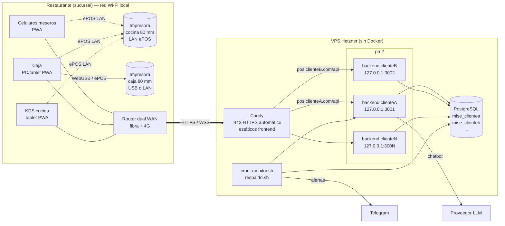

# 06 — Arquitectura y decisiones (ADR)

> ⚠️ **IMPORTANTE — REGLA DEL PROYECTO:** No se escribe ninguna línea de código hasta que esta documentación esté terminada y aprobada. La documentación vive en `Docs/` en formato `.md` y **se actualiza cada vez que se hace un cambio**. Registra cada cambio en el [Control de cambios](README.md#control-de-cambios).

## 1. Vista general

**Modelo multicliente obligatorio:** un solo código compilado una vez; por cada cliente (restaurante) un proceso backend, una base de datos PostgreSQL y un dominio. El aislamiento de datos es **por base**, no por `tenant_id`. Dentro de la base de un cliente puede haber varias sucursales (`branch_id`).



## 2. Estructura en el servidor

```
/opt/mise/
├── app/                         # repositorio clonado y compilado (una sola vez)
│   ├── backend/
│   │   ├── dist/                # compilado de Fastify (usado por TODOS los procesos)
│   │   └── prisma/              # schema/ (un .prisma por módulo) + migrations/
│   ├── frontend/
│   │   └── dist/                # PWA compilada (una sola para todos los clientes)
│   ├── shared/                  # contratos (esquemas Zod de la API y eventos) y dominio (cálculo de cuenta, folios) usados por backend y frontend
│   ├── scripts/                 # nuevo-cliente.sh, desplegar.sh, respaldo.sh, monitor.sh, ...
│   ├── templates/               # seed, plantillas de configuración inicial, Caddy y pm2
│   └── tests/                   # e2e (Playwright) y carga (k6)
│                                # Estructura completa del repositorio: doc 19
├── clients/
│   ├── ClienteA/
│   │   ├── .env                 # PORT, DATABASE_URL, JWT_SECRET, ... (chmod 600)
│   │   └── logs/
│   └── ClienteB/
│       └── .env
├── clients/registry.csv         # registro de clientes (nombre, puerto, dominio, base, estado, plan)
├── backups/
│   ├── ClienteA/2026-11-11_0300.dump
│   └── ClienteB/...
├── ecosystem.config.cjs         # generado: un app pm2 por cliente
└── monitor.env                  # TELEGRAM_BOT_TOKEN, TELEGRAM_CHAT_ID, umbrales
```

El archivo `/etc/caddy/Caddyfile` importa `/etc/caddy/clients/*.caddy` (un bloque por cliente). Detalle en [13-operacion.md](13-operacion.md).

## 3. Componentes

### 3.1 Caddy
- Un solo servicio del sistema (`systemd`), HTTPS automático (Let's Encrypt) por dominio.
- Sirve `app/frontend/dist` como archivos estáticos para **todos** los dominios.
  - `index.html`, `sw.js` y `manifest.webmanifest`: `Cache-Control: no-cache`.
  - `/assets/*` (archivos con hash): `Cache-Control: public, max-age=31536000, immutable`.
  - Fallback SPA: rutas desconocidas → `index.html`.
- `/api/*` y `/socket.io/*` de cada dominio → `127.0.0.1:<puerto del cliente>`.
- Compresión `zstd`/`gzip`, cabeceras de seguridad, límite de tamaño de petición (10 MB para imágenes).

### 3.2 Backend (un proceso por cliente)
- Node.js LTS + TypeScript + Fastify. Mismo `backend/dist` para todos los clientes.
- pm2 arranca cada proceso con `cwd: /opt/mise/clients/<Cliente>` y el backend carga `.env` desde `process.cwd()`.
- Escucha **solo** en `127.0.0.1:<PORT>`.
- Módulos internos (monolito modular), cada uno en `backend/src/modules/<módulo>/` ([19](19-estructura-del-proyecto.md)):

| Módulo | Responsabilidad |
|---|---|
| `system` | `GET /api/health`, `GET /api/time`, `GET /api/config/public` |
| `config` | Configuración del cliente, licencia, módulos, sucursales, regionales, plantillas de tickets |
| `auth` | Login, PIN, JWT, dispositivos, autorizaciones 🔑 |
| `catalog` | Menú, modificadores, combos, imágenes |
| `floor` | Zonas, mesas, ocupaciones |
| `orders` | Toma y envío de pedidos (rondas), ítems, cancelaciones, entrega |
| `kitchen` | KDS: cola FIFO, aceptar, listo (pedido e ítem), recall |
| `billing` | Cuentas, descuentos, propinas, pagos |
| `cash` | Turnos, movimientos, cortes |
| `recipes` | Insumos, recetas, costeo |
| `reports` | Dashboard, reportes, exportaciones |
| `ai` | Chatbot (capa semántica, proveedor LLM) |
| `sync` | Recepción de outbox, idempotencia, conflictos, folios |
| `audit` | Bitácora |
| `realtime` | Socket.IO, salas, eventos |

### 3.3 PostgreSQL
- Un servidor (versión LTS actual `[SUPUESTO: 17]`), solo escucha en `localhost`.
- Una base por cliente: `mise_<cliente>` (minúsculas). Dueño: rol `mise_<cliente>_app`. Rol de solo lectura para el chatbot: `mise_<cliente>_ro` con acceso solo al esquema `semantic`.
- Esquemas por base: `public` (tablas de la app) y `semantic` (vistas para reportes y chatbot).

### 3.4 Frontend (PWA)
- React + Vite + TypeScript, Tailwind CSS, TanStack Query, Dexie (IndexedDB), `vite-plugin-pwa` (Workbox).
- **Una sola compilación** para todos los clientes. Llama a la API con URL relativa `/api/...`; el dominio determina el cliente.
- Al cargar pide `GET /api/config/public` (nombre, logo, colores, textos, módulos, regionales) y aplica colores como variables CSS (`--color-primary`).
- Aplicaciones dentro de la misma PWA (rutas): `/mesero`, `/caja`, `/kds`, `/admin`, `/reportes`. El tipo de dispositivo registrado decide la ruta inicial.

### 3.5 Dispositivos e impresoras en el restaurante
| Dispositivo | Uso | Conexión a impresora |
|---|---|---|
| Celular de mesero | Mesas, pedidos, cuentas, pre-cuenta | Comanda y pre-cuenta por **ePOS LAN** a la impresora de cocina/caja |
| Caja (PC Windows o tablet Android) | Turno, cobro, recibo, corte, para llevar | Recibo por WebUSB / Web Serial / ePOS LAN / QZ Tray |
| KDS (tablet Android 10"+) | Cocina | Opcional: reimprimir comandas por ePOS LAN |
| Router dual WAN | Internet principal + 4G | — |

## 4. Reglas del código (obligatorias)

| # | Regla | Cómo se verifica |
|---|---|---|
| R1 | El backend toma toda su configuración del `.env` en `process.cwd()`; valida con Zod al arrancar y se niega a iniciar si falta algo. | Prueba de arranque sin `.env` → falla con mensaje claro. |
| R2 | Nada propio de un cliente en el código: nombre, logo, colores, módulos y licencia viven en `client_settings` / `license` de su base. | Revisión de código; búsqueda de literales. |
| R3 | El backend escucha solo en `127.0.0.1`. | `HOST` fijo en código a `127.0.0.1` (no configurable). |
| R4 | `GET /api/health` responde `{ status, uptime }` (y verifica la base con `SELECT 1`, timeout 2 s). | Monitor lo consulta cada minuto. |
| R5 | Las listas nunca devuelven columnas pesadas. Las imágenes se sirven por `GET /api/products/:id/image?v=<updatedAt>`. | `select` explícito en Prisma; prueba de tamaño de respuesta. |
| R6 | Migraciones solo aditivas, aplicadas a **todas** las bases antes de compilar. | Revisión de PR + script `verificar-migracion.sh` que rechaza `DROP`, `ALTER ... TYPE`, `RENAME`, `SET NOT NULL` sin default. |
| R7 | Frontend con URL relativa `/api/...` y una sola compilación. | No existe `VITE_API_URL`. |
| R8 | Frontend PWA con service worker y archivos con hash. | Lighthouse PWA. |

## 5. Decisiones de arquitectura (ADR)

### ADR-001 — Modelo multicliente: código compartido, una base por cliente
- **Estado:** Aceptado (requisito del negocio).
- **Contexto:** Se venderá a varios restaurantes; se necesita aislamiento fuerte, respaldos y restauraciones por cliente, y bajo costo.
- **Decisión:** Un código compilado una vez; por cliente: proceso pm2, base PostgreSQL y dominio. Sin `tenant_id`.
- **Consecuencias:** (+) Aislamiento simple, un error de consulta no expone a otro cliente, restauración por cliente trivial, se puede mover un cliente a otro servidor. (−) Cada proceso consume RAM (~150–300 MB); las migraciones deben aplicarse N veces; los reportes entre clientes (de RENGO) requieren consultar cada base.

### ADR-002 — Stack del backend: Fastify + Prisma + Zod + pino
- **Estado:** Aceptado.
- **Contexto:** Muchos procesos en un mismo VPS → la RAM por proceso es el recurso crítico.
- **Decisión:** Fastify (bajo consumo y alto rendimiento), Prisma con PostgreSQL, Zod para validar entradas y `.env`, pino para logs, argon2id para contraseñas/PIN, JWT.
- **Alternativas:** NestJS (más estructura, más RAM y arranque más lento); Express (más lento, sin esquemas nativos); Drizzle/Kysely en vez de Prisma (menos RAM, pero el pedido exige Prisma).
- **Notas:** Usar la versión de Prisma con cliente en TypeScript sin motor binario (*query compiler* / driver adapter `@prisma/adapter-pg`) si está estable a la fecha de inicio, porque reduce RAM y elimina el binario por proceso. Versiones aprobadas en **ADR-012** (PA-020). `connection_limit` por cliente en `DATABASE_URL`.

### ADR-003 — Impresión térmica
- **Estado:** Propuesto (requiere validación con hardware real, PA-021).
- **Contexto:** Sin servidor local, la comanda debe salir aunque no haya internet. Los meseros pueden usar iPhone. **Safari en iPhone/iPad no soporta WebUSB, Web Serial ni Web Bluetooth.** Un navegador no puede abrir sockets TCP crudos (puerto 9100).
- **Opciones evaluadas:**

| Opción | Cómo funciona | Android Chrome | Windows Chrome/Edge | iOS Safari | Sin internet | Riesgos |
|---|---|:-:|:-:|:-:|:-:|---|
| A. WebUSB + ESC/POS | El navegador genera ESC/POS y lo envía por USB | ✅ | ⚠️ requiere driver WinUSB (Zadig) porque el driver de Windows "toma" la impresora | ❌ | ✅ | Solo el dispositivo conectado por cable imprime |
| B. Web Serial | Impresoras USB-serial o seriales | ⚠️ limitado | ✅ | ❌ | ✅ | Pocas impresoras lo exponen |
| C. Web Bluetooth (BLE) | ESC/POS por BLE | ✅ | ✅ | ❌ | ✅ | Muchas impresoras baratas son BT clásico (SPP), no BLE; emparejamiento frágil |
| D. **Epson ePOS por red (LAN)** | La impresora expone un servicio HTTP(S) (ePOS-Print XML / ePOS SDK JS) en la red local | ✅ | ✅ | ✅ | ✅ (red local) | Página HTTPS → impresora: requiere habilitar HTTPS en la impresora y aceptar su certificado una vez por dispositivo; Chrome puede pedir permiso de "acceso a la red local"; atado a impresoras compatibles con ePOS |
| E. Agente QZ Tray en la PC de caja | Agente local con WebSocket en `localhost`; imprime por USB, LAN (9100) o driver | ❌ | ✅ | ❌ | ✅ | Instalar y mantener el agente; licencia comercial para quitar avisos; solo sirve a esa PC |
| F. Impresión delegada vía servidor | El dispositivo pide al backend; el backend avisa al "hub" (KDS/caja) por Socket.IO y el hub imprime con A–E | ✅ | ✅ | ✅ | ❌ | Depende de internet |

- **Decisión:**
  1. El frontend tiene una capa `PrintService` con transportes intercambiables (`webusb`, `webserial`, `webbluetooth`, `epos-lan`, `qz`, `delegate`) y genera ESC/POS en el navegador con `@point-of-sale/receipt-printer-encoder` (o XML ePOS para el transporte `epos-lan`).
  2. **Regla de quién imprime:** *imprime el dispositivo que origina el documento* por su ruta directa configurada. Si no tiene ruta directa, delega (opción F) al hub de impresión de la sucursal (solo con internet). Así el flujo es **el mismo con y sin internet**.
  3. **Hardware recomendado:** impresora de cocina **con Ethernet y Epson ePOS** (opción D), porque es la única ruta directa que funciona desde **cualquier** dispositivo, incluido iPhone, sin internet. Impresora de caja: ePOS LAN o USB (WebUSB en Android / QZ Tray en Windows).
  4. Cada dispositivo registrado tiene su ruta por tipo de documento (ver tabla `device_printer_routes`).
- **Consecuencias:** (+) La cocina recibe papel aunque se caiga internet y el KDS no reciba pedidos. (−) Configuración inicial por dispositivo (aceptar certificado de la impresora, permisos de red local); se documenta en el procedimiento de instalación. Si el cliente usa iPhone y su impresora no es ePOS, los iPhone **no** imprimen sin internet → se le exige un dispositivo Android o PC como respaldo.

### ADR-004 — Tiempo real con Socket.IO
- **Estado:** Aceptado.
- **Decisión:** Socket.IO sobre el mismo proceso Fastify del cliente, por `wss://<dominio>/socket.io`. Salas: `branch:<id>`, `branch:<id>:kds`, `branch:<id>:cash`, `user:<id>`, `device:<id>`. Autenticación con el JWT en el *handshake*.
- **Por qué no WebSocket nativo:** Socket.IO aporta reconexión automática con espera exponencial, *heartbeats*, salas y *fallback* a long-polling (redes de restaurante con proxies o 4G inestable). El costo de RAM es bajo.
- **Sin adaptador Redis:** cada cliente tiene un solo proceso. Si un cliente necesitara varios procesos (cluster), se añadiría `@socket.io/postgres-adapter` (sin Redis nuevo).
- **Recuperación:** los eventos llevan `seq` por sucursal; al reconectar el cliente envía su último `seq` y el servidor responde con los eventos perdidos (tabla `realtime_events`, retención 24 h) o con instrucción de recargar el estado completo.

### ADR-005 — Modo sin internet sin servidor local
- **Estado:** Aceptado. Detalle en [09-modo-sin-internet.md](09-modo-sin-internet.md).
- **Decisión:** Mitigación en capas: (1) router dual WAN con 4G; (2) PWA offline-first con IndexedDB (Dexie), outbox idempotente y folios temporales; (3) impresión local directa (ADR-003); (4) procedimiento de contingencia en papel.
- **Alternativa descartada:** servidor local (on-premise) — fuera de alcance por costo de hardware, soporte y sincronización bidireccional.
- **Limitación aceptada:** sin internet los dispositivos no se ven entre sí.

### ADR-006 — Identificadores ULID generados en el dispositivo
- **Estado:** Aceptado.
- **Decisión:** Toda entidad operativa (ocupación, pedido, ítem, cuenta, pago, movimiento de caja) usa ULID generado en el cliente; se guarda como `uuid` en PostgreSQL (ULID es compatible en 128 bits). Los catálogos también usan ULID para uniformidad.
- **Por qué:** permite crear registros offline sin colisiones y ordenarlos por tiempo.

### ADR-007 — Migraciones aditivas con `prisma migrate deploy`
- **Estado:** Aceptado.
- **Decisión:** Las migraciones se generan en desarrollo con `prisma migrate dev`, se revisan (solo `CREATE TABLE`, `ADD COLUMN` opcional o con `DEFAULT`, `CREATE INDEX CONCURRENTLY`) y en producción se aplican con `prisma migrate deploy` a cada base, **antes** de compilar y reiniciar. Prohibido `prisma db push` en producción.
- **Por qué:** con N bases y un solo código, durante el despliegue el código viejo convive con el esquema nuevo; si la migración solo agrega, el código viejo sigue funcionando y un fallo a mitad no rompe a ningún cliente.
- **Eliminar algo:** en dos versiones: (1) el código deja de usarlo; (2) en una versión posterior y documentada, se elimina con un ADR específico.

### ADR-008 — Autenticación por dispositivo
- **Estado:** Aceptado.
- **Decisión:** Registro de dispositivo por un administrador (código de emparejamiento de 6 dígitos válido 10 min). Cada dispositivo tiene un `device_token` de larga duración (revocable). Las sesiones de usuario se abren sobre un dispositivo registrado: usuario+contraseña o PIN → JWT de acceso (15 min) que se refresca solo mientras se usa la app + token de refresco rotativo que vence tras **12 horas sin actividad** (S-04). No hay bloqueo de pantalla por inactividad. `JWT_SECRET` distinto por cliente.

### ADR-009 — Imágenes en la base, en tabla separada
- **Estado:** Aceptado.
- **Decisión:** Las imágenes de productos y el logo se guardan redimensionadas (WebP, máx. 800 px, ≤ 150 KB) en la tabla `media` (`bytea`), separada de `products`. Se sirven por ruta propia con `ETag` y `Cache-Control: immutable` usando `?v=<updatedAt>`.
- **Por qué:** el respaldo `pg_dump` de un cliente queda completo y autocontenido; mover un cliente de servidor es solo mover su base. Volumen esperado bajo (cientos de imágenes).
- **Alternativa:** archivos en `clients/<Cliente>/uploads/` — más eficiente para volúmenes grandes; se reconsidera si un cliente supera 500 MB de imágenes.

### ADR-010 — Chatbot sobre capa semántica, no SQL libre
- **Estado:** Aceptado. Detalle en [10-chatbot-ia.md](10-chatbot-ia.md).
- **Decisión:** El LLM no genera SQL. Elige una **métrica** y **dimensiones/filtros** de un catálogo cerrado (llamada a herramienta con esquema JSON); el backend construye la consulta parametrizada sobre vistas del esquema `semantic` con el rol de solo lectura.

### ADR-011 — Montos en `numeric` y tiempos en `timestamptz`
- **Estado:** Aceptado.
- **Decisión:** Montos `numeric(12,2)`; en TypeScript se manejan con una librería decimal (`decimal.js` o enteros en centavos en el frontend). Fechas en UTC (`timestamptz`); el "día de negocio" se calcula con la zona horaria de la sucursal y una hora de corte configurable (ej. 04:00) para restaurantes que cierran después de medianoche.

### ADR-012 — Versiones del runtime: Node.js 24 LTS
- **Estado:** **Aceptado** por RENGO el 2026-11-11 (resuelve PA-020).
- **Contexto:** El backend corre en Node (Fastify, Prisma, argon2) y el frontend usa Node solo para compilar (Vite). React corre en el navegador, así que la versión de Node afecta a **Vite y a las herramientas**, no a React.

| Línea de Node | Estado al 2026-11-11 | Fin de soporte |
|---|---|---|
| 22 "Jod" | Mantenimiento | 2027-04-30 — demasiado pronto: vencería durante la Fase 2 |
| **24 "Krypton"** | Mantenimiento LTS desde 2026-10-20 | **2028-04-30** |
| 26 "Lithium" | Active LTS desde 2026-10-28 | 2029-04-30 |

| Pieza del stack | Versión actual | Node que soporta | Con Node 24 | Con Node 26 |
|---|---|---|:-:|:-:|
| React | 19.3 (sep. 2026) | Corre en el navegador | ✅ | ✅ |
| Vite | 8 | 20.19+, 22.12+ | ✅ | ✅ |
| Fastify | 5 | 20+; en sus pruebas ya corre Node 24 y 26 | ✅ | ✅ |
| Prisma ORM | 7 (estable) | ^20.19, ^22.12, ^24.0 — **no lista 26** | ✅ | ⚠️ |
| Prisma ORM | 8 (*release candidate*) | 22.18+, 24.11+, 26+; **recomienda 24** | ✅ | ✅ |
| argon2 | Módulo nativo | Requiere binarios precompilados para la versión de Node | ✅ | ⚠️ verificar |

- **Decisión:** **Node.js 24 LTS** (la versión 24.x más reciente, mínimo 24.11 para ser compatible también con Prisma 8), **Prisma ORM 7** con el cliente sin motor Rust (`prisma-client`) y `@prisma/adapter-pg`, Fastify 5, Vite 8, React 19 y TypeScript ≥ 5.9.
  - La versión se fija en el repositorio (`.nvmrc` y `engines` en `package.json`) y en el servidor (instalación desde el repositorio oficial de Node, doc 13 §1).
- **Por qué no Node 26:** lleva menos de un mes como LTS, Prisma 7 estable no lo soporta oficialmente y hay que verificar los binarios de argon2. Node 24 tiene soporte de seguridad hasta abril de 2028, suficiente para el MVP y la Fase 2.
- **Plan de actualización:** pasar a Node 26 cuando Prisma lo soporte en una versión estable, después de probarlo en staging, y siempre antes de 2028-04-30. La actualización es un despliegue normal (doc 13 §4) porque todos los clientes usan el mismo runtime.
- **Pendiente de confirmar en la Semana 0:** el esquema Prisma en varios archivos (`backend/prisma/schema/`, doc 19) con Prisma 7 y `prisma.config.ts`, y que Prisma 7 ya no carga el `.env` solo (el backend lo carga desde `process.cwd()`, regla R1).
- **Fuentes:** calendario oficial de Node.js (`nodejs/Release`), requisitos de Prisma 7 y 8 en prisma.io, anuncio de Vite 8, guía de migración de Fastify 5 y blog de React 19.3.

## 6. Seguridad (resumen)

| Capa | Medida |
|---|---|
| Red | ufw: 22 (solo llave), 80, 443. PostgreSQL y backends solo en `localhost`. fail2ban en SSH. |
| Transporte | HTTPS/WSS por Caddy, HSTS. |
| Identidad | argon2id; JWT por cliente; dispositivos registrados y revocables; bloqueo por intentos. |
| Autorización | Permisos evaluados en el backend en cada petición; filtrado por sucursal. |
| Datos | Una base por cliente; rol de solo lectura para el chatbot; secretos solo en `.env` (600). |
| Auditoría | Bitácora inmutable (solo `INSERT`; el rol de la app no tiene `UPDATE/DELETE` sobre `audit_log`). |
| Sistema | Actualizaciones automáticas de seguridad (`unattended-upgrades`); usuario de servicio `mise` sin shell de login para pm2. |

## 7. Hardware recomendado

> **Propuesta de trabajo (PA-021, 2026-11-12):** RENGO todavía no elige los equipos. Mientras tanto se desarrolla y se prueba con este kit. Si al final se eligen otros equipos, se revisa ADR-003 y la prueba de impresión (doc 14 §7).

### 7.1 Idea principal: los meseros usan su propio celular
En muchos restaurantes los meseros tomarán pedidos **con su teléfono** y no habrá tablets. Esto define el kit:

1. **Las impresoras deben ser Epson con ePOS por red (LAN).** Es el único transporte que funciona desde **cualquier** celular, incluido iPhone (Safari no soporta USB ni Bluetooth, ADR-003). Una impresora solo USB o solo Bluetooth dejaría sin imprimir a los meseros con iPhone.
2. **Los celulares deben estar en el Wi-Fi del personal**, en la misma red que las impresoras. Si un celular se sale del Wi-Fi y usa sus datos, ya no ve la impresora: la comanda se imprime por el transporte `delegate` (otro dispositivo de la sucursal la imprime) mientras haya internet; sin internet, ese celular no imprime.
3. **La pantalla de cocina (KDS) es opcional.** Con la comanda impresa la cocina puede trabajar sin pantalla. Si el restaurante quiere KDS, basta una tablet Android sencilla en la pared.
4. **La caja puede ser una PC o laptop que el restaurante ya tenga**, con Chrome o Edge.

### 7.2 Kit de referencia

| Equipo | Propuesta de trabajo | Alternativa | Notas |
|---|---|---|---|
| Celular de mesero (propio) | Android 10+ con Chrome actual, o iPhone con iOS 16.4+ y Safari; 3 GB de RAM | — | Requisitos mínimos para instalar la PWA. Cada celular se empareja como dispositivo (RF-031) |
| Impresora de cocina | **Epson TM-m30III**, modelo con Ethernet (80 mm, corte automático, ePOS-Print) | **Epson TM-T20III Ethernet** (más barata; la ficha de Epson indica soporte ePOS para imprimir desde web y móviles) | Confirmar con el distribuidor local que el modelo trae **ePOS** antes de comprar. IP fija por DHCP |
| Impresora de caja | La misma que en cocina (TM-m30III Ethernet) | TM-T20III Ethernet | Mismo modelo = repuesto intercambiable y un solo transporte (`epos-lan`), sin QZ Tray |
| Cajón de dinero | Cajón estándar con conector RJ11 a la impresora de caja | — | Lo abre la impresora al cobrar en efectivo |
| Caja | PC o laptop del restaurante con Windows 10/11 y Chrome/Edge | Tablet Android 10" o el celular del cajero | Con impresora ePOS no se necesita instalar nada en la PC |
| KDS (opcional) | Tablet Android 10" (4 GB de RAM) con soporte de pared y cargador fijo | Sin KDS: solo comanda impresa | La pantalla queda siempre encendida (doc 03 §6) |
| Router | **TP-Link ER605** (dual WAN con *Link Backup*), administrado con Omada | MikroTik con dual WAN | Configurar la detección de caída con un servidor de *echo*; probar el cambio de enlace antes de entregar |
| Respaldo de internet | **Router 4G con salida Ethernet** conectado a la segunda WAN del ER605 | Módem USB 4G | Se prefiere el router 4G por Ethernet: hay reportes de módems USB que se desconectan |
| Wi-Fi | Punto de acceso TP-Link Omada (EAP) con red del personal separada de la de clientes | Wi-Fi del ER605 + router actual | Cobertura en cocina, salón, terraza y caja (doc 09 §2) |
| UPS | UPS de 600–750 VA para router, router 4G, punto de acceso e impresora de cocina | — | ≥ 30 min de respaldo |
| Internet | Fibra o cable ≥ 25 Mbps | — | Plan de datos 4G ≥ 5 GB/mes |

**Consumo de datos estimado** por sucursal: < 300 MB/día `[SUPUESTO]` (sin contar la primera carga de la PWA e imágenes).

### 7.3 Antes de comprar
- Pedir al distribuidor en Guatemala precio y disponibilidad de la TM-m30III Ethernet y la TM-T20III Ethernet, y confirmar que traen ePOS.
- Hacer la **prueba de impresión** de la Semana 0 (doc 17) con la impresora real, desde un Android y desde un iPhone, por HTTPS.
- Verificar que el Wi-Fi del restaurante **no** aísle a los clientes en la red del personal (si no, los celulares no ven la impresora).

## 8. Escalabilidad del servidor

Ver [13-operacion.md](13-operacion.md#7-límites-y-crecimiento) para cálculos de RAM, conexiones y disco, y el plan de crecimiento (más RAM/CPU → PostgreSQL en su propia máquina → repartir clientes entre servidores).
