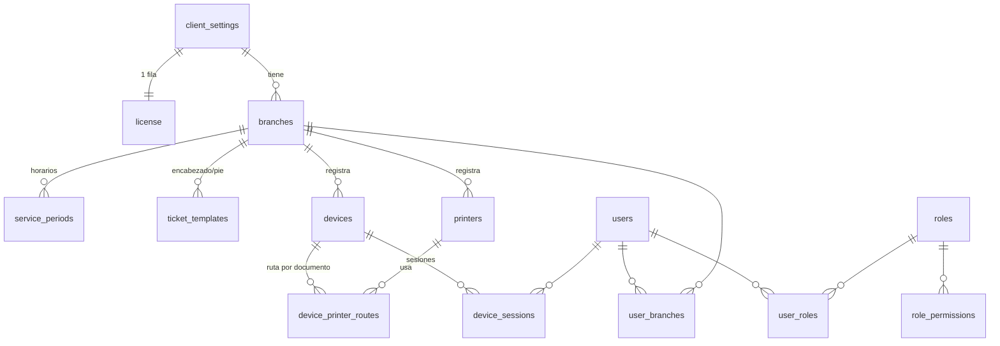
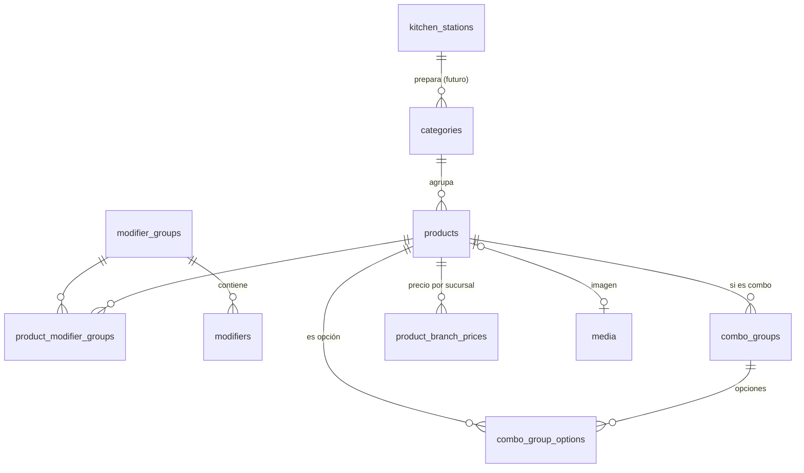
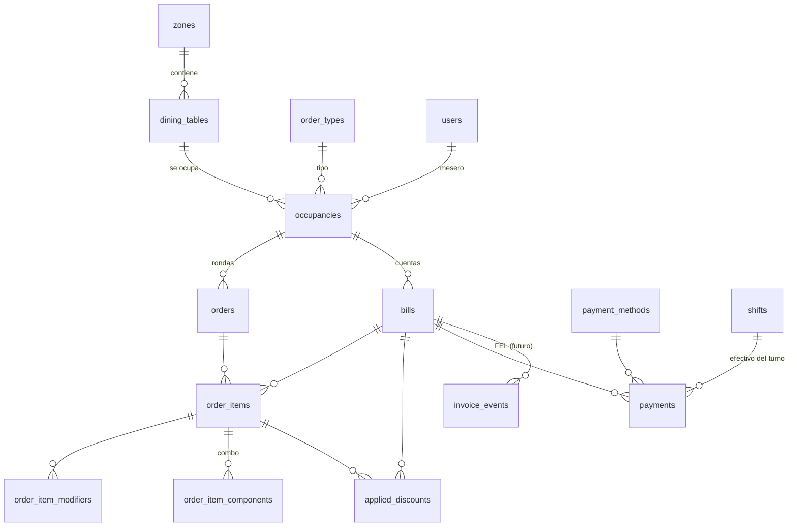
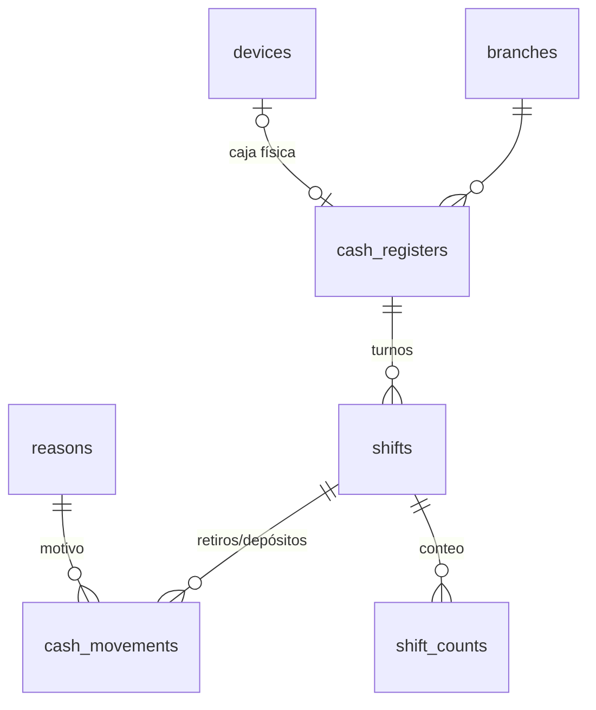
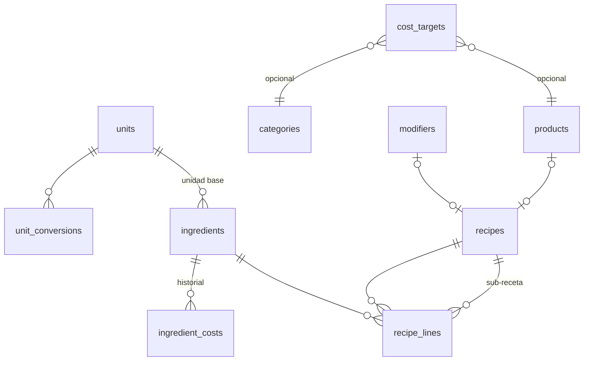
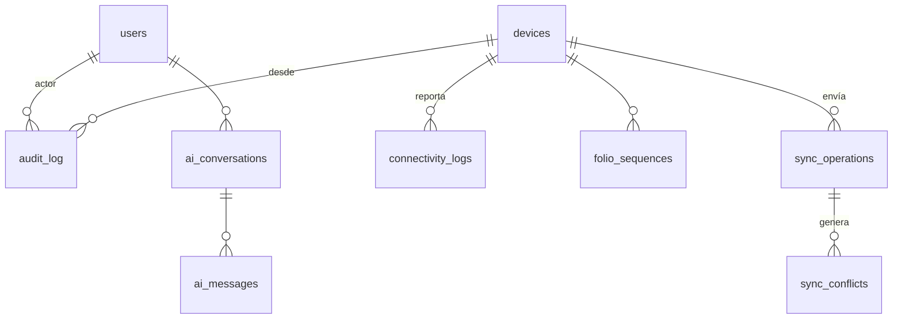

# 07 — Modelo de datos

> ⚠️ **IMPORTANTE — REGLA DEL PROYECTO:** No se escribe ninguna línea de código hasta que esta documentación esté terminada y aprobada. La documentación vive en `Docs/` en formato `.md` y **se actualiza cada vez que se hace un cambio**. Registra cada cambio en el [Control de cambios](README.md#control-de-cambios).

## 1. Convenciones

- Una base por cliente (`mise_<cliente>`). **No** existe `tenant_id`. Las entidades operativas llevan `branch_id`.
- Claves primarias `id uuid` con valor ULID generado por el cliente o el servidor (ADR-006).
- Toda tabla tiene `created_at timestamptz default now()` y `updated_at timestamptz`. Las tablas que se sincronizan offline tienen además `created_device_id`, `version int default 1` (bloqueo optimista).
- Montos `numeric(12,2)`; porcentajes `numeric(5,2)`; cantidades de receta `numeric(12,4)`.
- Borrado lógico (`active boolean` o `deleted_at`) en catálogos; **nunca** se borran registros operativos.
- Estados como `text` con `CHECK` (no `enum` de PostgreSQL) para poder **agregar** valores con migraciones aditivas.
- Columnas pesadas (`bytea`, textos largos) en tablas separadas (`media`, `ai_messages`) para que las listas no las carguen.

## 2. Modelo conceptual de una mesa

```
Mesa ──1:N── Ocupación ──1:N── Pedidos (rondas) ──1:N── Ítems
                  │                                       │
                  └──1:N── Cuentas ───────────1:N─────────┘
                              └──1:N── Pagos
```
- Un **ítem** tiene exactamente un `order_id` y un `bill_id` (RF-103).
- Una ocupación de "para llevar" tiene `table_id = null` y `order_type = PARA_LLEVAR`.

## 3. Diagramas entidad-relación

### 3.1 Configuración, usuarios y dispositivos


### 3.2 Menú


### 3.3 Operación: mesas, pedidos, cuentas y pagos


### 3.4 Caja


### 3.5 Recetas y costeo


### 3.6 Sistema: auditoría, sincronización, tiempo real, IA


## 4. Descripción de tablas

### 4.1 Configuración y licencia

**`client_settings`** (una sola fila) — datos del cliente que el frontend pide al cargar.
| Columna | Tipo | Nota |
|---|---|---|
| id | uuid PK | |
| legal_name, trade_name | text | |
| nit | text | |
| logo_media_id | uuid FK media | |
| color_primary, color_secondary | text | Hex |
| currency_code | text | Default `GTQ` |
| currency_symbol | text | Default `Q` |
| decimals | smallint | Default 2 |
| locale | text | Default `es-GT` |
| timezone | text | Default `America/Guatemala` |
| business_day_cutoff | time | Hora de corte del día de negocio (default 04:00) |
| tip_suggested_pct | numeric(5,2) | Ej. 10.00; null = sin sugerencia |
| tip_editable, tip_applies_takeaway | boolean | |
| tip_base | text | `AFTER_DISCOUNT` / `BEFORE_DISCOUNT` |
| kds_thresholds | jsonb | `{ "warnMin": 10, "lateMin": 20, "from": "SENT" }` |
| kds_sound | jsonb | `{ "tone": "bell", "volume": 0.8, "repeatSec": 30 }` |
| cash_diff_threshold | numeric(12,2) | Diferencia que exige comentario |
| auto_print_receipt | boolean | |
| offline_policy | jsonb | Qué se permite sin conexión (ver doc 09) |
| ui_texts | jsonb | Sobrescritura de textos `{ "table": "Mesa" }` |
| settings_version | int | Incrementa con cada cambio (invalida caché en dispositivos) |

**`license`** (una fila)
| Columna | Tipo | Nota |
|---|---|---|
| plan | text | `BASICO`, `PRO`, ... `[PENDIENTE DE DEFINIR]` planes comerciales |
| status | text | `ACTIVA`, `GRACIA`, `SOLO_LECTURA`, `SUSPENDIDA` |
| modules | jsonb | `{ "recipes": true, "ai": false, "multiBranch": false, "advancedReports": true }` |
| limits | jsonb | `{ "branches": 1, "devices": 15, "aiQuestionsPerDay": 50, "aiTokensPerMonth": 500000 }` |
| valid_until | date | |
| grace_days | int | |
| updated_by_platform_at | timestamptz | Solo la modifican scripts de plataforma |

**`branches`**: id, name, address, phone, nit_override, timezone (null = la del cliente), active, folio_prefix (ej. `C` para Centro).
**`service_periods`**: id, branch_id, name ("Almuerzo"), weekday (0–6), start_time, end_time.
**`ticket_templates`**: id, branch_id, doc_type (`COMANDA`, `PRECUENTA`, `RECIBO`, `CORTE`, `MOVIMIENTO`), header text, footer text, show_logo, paper_width (`58`/`80`), options jsonb.
**`order_types`**: id, code (`MESA`, `PARA_LLEVAR`; extensible), name, requires_table boolean, active. Delivery **no** se crea; queda como valor posible futuro.
**`reasons`**: id, type (`CANCEL_ITEM`, `VOID_BILL`, `DISCOUNT`, `CASH_WITHDRAWAL`, `CASH_DEPOSIT`, `CONFLICT`), name, active, sort.

### 4.2 Usuarios, roles y dispositivos

**`users`**: id, full_name, username (único), email (opcional), password_hash (argon2id), pin_hash (argon2id), pin_set_at, active, failed_attempts, locked_until, last_login_at.
**`roles`**: id, name, description, max_discount_pct, max_discount_amount, is_system (no se puede borrar el de administrador).
**`role_permissions`**: role_id, permission_code (catálogo en [03](03-actores-roles-permisos.md#3-catálogo-de-permisos); los códigos son del producto, no del cliente).
**`user_roles`**: user_id, role_id. **`user_branches`**: user_id, branch_id.
**`devices`**: id, branch_id, name, type (`WAITER`, `CASH`, `KDS`, `ADMIN`), device_token_hash, offline_prefix (ej. `M3`), platform (user agent resumido), last_seen_at, app_version, revoked_at.
**`device_sessions`**: id, device_id, user_id, refresh_token_hash, expires_at, revoked_at, ip.
**`printers`**: id, branch_id, name, transport (`WEBUSB`, `WEBSERIAL`, `WEBBLUETOOTH`, `EPOS_LAN`, `QZ`), address (IP, nombre QZ o identificador USB vendor/product), paper_width, codepage, cut, drawer_kick boolean, active.
**`device_printer_routes`**: device_id, doc_type, printer_id, mode (`DIRECT` / `DELEGATE`), copies.

### 4.3 Menú

**`categories`**: id, name, parent_id (opcional), color, icon, sort, station_id (FK `kitchen_stations`, default la única), active.
**`kitchen_stations`**: id, branch_id, name, printer_id, is_default. *En MVP existe una por sucursal; el ruteo por categoría está modelado pero no expuesto.*
**`products`**: id, category_id, name, short_description, sku (código interno, único), price numeric(12,2) (impuestos incluidos), is_combo, status (`ACTIVE`, `SOLD_OUT`, `INACTIVE`), image_media_id, sort, cost_target_override, updated_at (usado en `?v=`).
**`product_branch_prices`**: product_id, branch_id, price.
**`modifier_groups`**: id, name, required, min_select, max_select, sort.
**`modifiers`**: id, group_id, name, price_delta numeric(12,2) ≥ 0, status, sort.
**`product_modifier_groups`**: product_id, group_id, sort.
**`combo_groups`**: id, combo_product_id, name ("Bebida"), min_select, max_select, sort.
**`combo_group_options`**: id, combo_group_id, product_id, price_delta, default.
**`media`**: id, mime, bytes (`bytea`), width, height, sha256, created_at. *Nunca se incluye en listas.*

### 4.4 Mesas y operación

**`zones`**: id, branch_id, name, sort, active.
**`dining_tables`**: id, zone_id, name ("5", "T2"), capacity, shape, pos_x, pos_y, width, height, status (`LIBRE`, `OCUPADA`, `UNIDA`, `BLOQUEADA`), current_occupancy_id, version.

**`occupancies`**
| Columna | Tipo | Nota |
|---|---|---|
| id | uuid PK | ULID del dispositivo |
| branch_id | uuid FK | |
| table_id | uuid FK null | Null para para llevar |
| order_type_id | uuid FK | |
| waiter_id | uuid FK users | |
| guests | smallint | |
| customer_name, customer_phone | text null | Para llevar |
| status | text | `ABIERTA`, `CERRADA`, `FUSIONADA`, `CANCELADA` |
| merged_into_id | uuid FK occupancies null | Unir mesas |
| owner_device_id | uuid FK devices | Dispositivo "a cargo" (offline) |
| opened_at, closed_at | timestamptz | |
| business_date | date | Día de negocio (zona horaria + corte) |
| created_device_id, version | | |

Índice único parcial: `UNIQUE (table_id) WHERE status = 'ABIERTA'` → impide dos ocupaciones abiertas en la misma mesa.

**`orders`** (rondas)
| Columna | Tipo | Nota |
|---|---|---|
| id | uuid PK | |
| occupancy_id | uuid FK | |
| branch_id, station_id | uuid FK | |
| round_number | smallint | 1, 2, 3… (≥ 2 → "ADICIONAL") |
| folio | text null | Definitivo, asignado por servidor (`C-000123`) |
| temp_folio | text null | Temporal offline (`M3-0005`) |
| status | text | `ENVIADO`, `EN_PREPARACION`, `LISTO`, `ENTREGADO`, `CANCELADO` |
| sent_by | uuid FK users | |
| sent_at, accepted_at, ready_at, delivered_at | timestamptz | Marcas de tiempo de los 3 tiempos |
| accepted_by, ready_by, delivered_by | uuid FK users | |
| delivered_auto | boolean | Marcado entregado automáticamente |
| synced_late | boolean | Llegó al servidor desde la outbox después de un corte |
| printed_at, print_device_id | | Confirmación de impresión de comanda |
| created_device_id, version | | |

**`order_items`**
| Columna | Tipo | Nota |
|---|---|---|
| id | uuid PK | |
| order_id | uuid FK | **Uno solo** |
| bill_id | uuid FK | **Una sola** (RF-103) |
| product_id | uuid FK | |
| product_name_snapshot | text | Nombre al momento de vender |
| quantity | numeric(8,2) | Entero en MVP |
| unit_price | numeric(12,2) | Congelado |
| modifiers_total | numeric(12,2) | Σ modificadores por unidad |
| line_total | numeric(12,2) | (unit_price + modifiers_total) × quantity |
| unit_cost_snapshot | numeric(12,4) | Costo teórico congelado (RF-139) |
| note | text | Máx. 140 |
| status | text | `ENVIADO`, `EN_PREPARACION`, `LISTO`, `ENTREGADO`, `CANCELADO` |
| cancelled_at, cancelled_by, authorized_by, cancel_reason_id, cancel_after_ready | | |
| ready_at | timestamptz | Listo por ítem |
| created_device_id, version | | |

**`order_item_modifiers`**: id, order_item_id, modifier_id, name_snapshot, price_delta, cost_snapshot.
**`order_item_components`**: id, order_item_id, combo_group_id, product_id, name_snapshot, price_delta, cost_snapshot, modifiers jsonb.

**`bills`** (cuentas)
| Columna | Tipo | Nota |
|---|---|---|
| id | uuid PK | |
| occupancy_id | uuid FK | |
| name | text | "Cuenta 1", "Ana" |
| status | text | `ABIERTA`, `PRECUENTA`, `PAGADA`, `ANULADA`, `ELIMINADA` |
| folio | text | Folio de recibo |
| subtotal, discount_total, tip_amount, total | numeric(12,2) | Calculados por el servidor |
| tip_pct | numeric(5,2) | |
| paid_at, paid_by, cash_register_id, shift_id | | |
| voided_at, voided_by, void_authorized_by, void_reason_id | | |
| precheck_count | int | Veces impresa la pre-cuenta |
| customer_nit | text null | **FEL** — NIT o `CF` |
| customer_tax_name | text null | **FEL** — nombre del receptor |
| invoice_status | text | **FEL** — `NO_REQUERIDA` (default), `PENDIENTE`, `EN_PROCESO`, `EMITIDA`, `ERROR`, `ANULACION_PENDIENTE`, `ANULADA` |
| invoice_number, invoice_uuid | text null | **FEL** — los llenará el RPA |
| owner_device_id, created_device_id, version | | |

**`applied_discounts`**: id, bill_id null, order_item_id null (exactamente uno de los dos), kind (`PCT`, `AMOUNT`), value, amount (calculado), reason_id, applied_by, authorized_by, created_device_id.
**`payment_methods`**: id, name, kind (`CASH`, `CARD`, `TRANSFER`, `OTHER`), gives_change, requires_reference, active, sort.
**`payments`**: id, bill_id, method_id, amount (aplicado a la cuenta), tendered (entregado por el cliente, efectivo), change_given, reference, shift_id (obligatorio si `CASH`), status (`APLICADO`, `REVERTIDO`, `EN_CONFLICTO`), received_by, created_device_id, idempotency_key.

### 4.5 Caja

**`cash_registers`**: id, branch_id, name ("Caja 1"), device_id, active.
**`shifts`**: id, cash_register_id, opened_by, opened_at, opening_float, status (`ABIERTO`, `EN_CORTE`, `CERRADO`), closed_by, closed_at, expected_cash, counted_cash, difference, comment, report_snapshot jsonb (totales congelados al cerrar). Índice único parcial: un `ABIERTO` por caja.
**`cash_movements`**: id, shift_id, type (`DEPOSITO`, `RETIRO`, `REVERSO_ANULACION`), amount, reason_id, note, user_id, authorized_by.
**`shift_counts`**: shift_id, denomination numeric, quantity.

### 4.6 Recetas y costeo

**`units`**: id, code (`kg`, `g`, `l`, `ml`, `u`, `oz`), name, dimension (`MASS`, `VOLUME`, `COUNT`).
**`unit_conversions`**: from_unit_id, to_unit_id, factor (ej. kg→g = 1000). Conversiones por insumo (ej. 1 u de huevo = 50 g) en `ingredient_unit_conversions` `[SUPUESTO]`.
**`ingredients`**: id, name, category, base_unit_id, current_unit_cost numeric(12,4), active.
**`ingredient_costs`**: id, ingredient_id, unit_cost, valid_from, set_by. (Historial; sin compras ni existencias.)
**`recipes`**: id, product_id null, modifier_id null, combo_option_id null, is_subrecipe, name, yield_qty, yield_unit_id, computed_cost, computed_at.
**`recipe_lines`**: id, recipe_id, ingredient_id null, subrecipe_id null, quantity, unit_id, waste_pct.
**`cost_targets`**: id, scope (`CLIENT`, `CATEGORY`, `PRODUCT`), category_id, product_id, target_food_cost_pct (ej. 30.00), rounding_step (ej. 0.50 o 1.00), rounding_mode (`UP`, `NEAREST`).

Fórmulas: `costo = Σ cantidad_convertida × (1 + merma%) × costo_unitario`; `precio_sugerido = redondeo(costo / food_cost_pct)`; `margen_real = (precio − costo) / precio`.

### 4.7 Auditoría, sincronización y sistema

**`audit_log`** (solo `INSERT`)
| Columna | Tipo | Nota |
|---|---|---|
| id | bigserial | |
| at | timestamptz | Hora del servidor |
| client_at | timestamptz | Hora del dispositivo (offline) |
| branch_id, user_id, authorized_by, device_id | | |
| ip | inet | |
| action | text | `bill.void`, `item.cancel`, `discount.apply`, `config.menu.update`, `auth.login_failed`, ... |
| entity, entity_id | text, uuid | |
| before, after | jsonb | Solo campos cambiados |
| reason_id, note | | |

**`sync_operations`**: idempotency_key (PK, texto), device_id, op_type, entity_id, received_at, client_created_at, client_seq, status (`APLICADA`, `DUPLICADA`, `CONFLICTO`, `RECHAZADA`), result jsonb.
**`sync_conflicts`**: id, branch_id, type (`PAGO_DUPLICADO`, `CANCELACION_SOBRE_PAGADA`, `MESA_DOBLE`, `TURNO_DOBLE`, `ITEM_EN_CUENTA_PAGADA`, `PRECIO_CAMBIADO`, ...), entities jsonb, detail jsonb, status (`ABIERTO`, `RESUELTO`), resolution, resolved_by, resolved_at.
**`folio_sequences`**: branch_id, doc_type (`ORDER`, `BILL`), last_value. Folio definitivo con `UPDATE ... RETURNING` en la transacción.
**`connectivity_logs`**: id, device_id, offline_from, offline_to, duration_s, pending_ops_max, network_type, notes.
**`realtime_events`**: seq bigserial, branch_id, event, payload jsonb, at (retención 24 h).
**`ai_conversations`**: id, user_id, branch_scope, started_at.
**`ai_messages`**: id, conversation_id, role, content text, tool_call jsonb, semantic_query jsonb, rows_returned, tokens_in, tokens_out, cost_usd, latency_ms, flagged.
**`ai_usage_daily`**: date, questions, tokens_in, tokens_out, cost_usd.

### 4.8 Punto de extensión FEL

**`invoice_events`** — cola que consumirá el RPA (fuera de alcance; la tabla existe desde el MVP).
| Columna | Tipo | Nota |
|---|---|---|
| id | uuid PK | |
| bill_id | uuid FK | |
| type | text | `EMITIR`, `ANULAR` |
| status | text | `PENDIENTE`, `TOMADO`, `COMPLETADO`, `ERROR`, `DESCARTADO` |
| attempts | int | |
| next_attempt_at | timestamptz | Espera exponencial |
| locked_by, locked_at | text, timestamptz | Para que el RPA tome eventos con `SELECT ... FOR UPDATE SKIP LOCKED` |
| payload | jsonb | Snapshot de la cuenta: ítems, totales, NIT, nombre |
| result | jsonb | Número de autorización, serie, UUID SAT |
| last_error | text | |

Reglas: pagar una cuenta con `customer_nit` → `invoice_status = PENDIENTE` + evento `EMITIR`. Anular cuenta con factura `EMITIDA` → `ANULACION_PENDIENTE` + evento `ANULAR`. **`[PENDIENTE DE DEFINIR]`** desglose de IVA incluido (PA-002): se agregará una columna o vista sin cambiar las existentes.

## 5. Vistas de la capa semántica (esquema `semantic`)

Usadas por reportes y por el chatbot (rol de solo lectura). Detalle en [10-chatbot-ia.md](10-chatbot-ia.md) y [12-catalogo-reportes.md](12-catalogo-reportes.md).

| Vista | Granularidad | Columnas clave |
|---|---|---|
| `semantic.sales_items` | Ítem vendido (cuenta pagada, no cancelado) | business_date, hour, weekday, branch, category, product, waiter, order_type, quantity, net_amount, cost |
| `semantic.bills_paid` | Cuenta pagada | business_date, branch, waiter, order_type, guests, subtotal, discount, tip, total |
| `semantic.payments` | Pago aplicado | business_date, branch, method, method_kind, amount, shift |
| `semantic.kitchen_times` | Pedido | business_date, branch, wait_s, prep_s, delivery_s |
| `semantic.cancellations` | Ítem cancelado / cuenta anulada | business_date, branch, user, reason, amount, after_ready |
| `semantic.discounts` | Descuento | business_date, branch, user, reason, amount |
| `semantic.shifts` | Turno | branch, register, opened_at, expected, counted, difference |
| `semantic.ingredient_usage` | Insumo × día | business_date, branch, ingredient, unit, theoretical_qty, theoretical_cost |

Las vistas **no** exponen nombres ni teléfonos de clientes, NIT ni datos de usuarios distintos al nombre del mesero.

## 6. Índices principales

| Tabla | Índice |
|---|---|
| occupancies | `(branch_id, status)`, único parcial `(table_id) WHERE status='ABIERTA'` |
| orders | `(branch_id, status, sent_at)` para KDS FIFO |
| order_items | `(order_id)`, `(bill_id)` |
| bills | `(occupancy_id)`, `(status, paid_at)` |
| payments | `(bill_id)`, `(shift_id)`, único `(idempotency_key)` |
| audit_log | `(at)`, `(entity, entity_id)` |
| sync_operations | PK `idempotency_key` |
| invoice_events | `(status, next_attempt_at)` |
