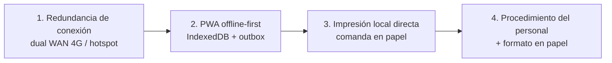

# 09 — Especificación del modo sin internet

> ⚠️ **IMPORTANTE — REGLA DEL PROYECTO:** No se escribe ninguna línea de código hasta que esta documentación esté terminada y aprobada. La documentación vive en `Docs/` en formato `.md` y **se actualiza cada vez que se hace un cambio**. Registra cada cambio en el [Control de cambios](README.md#control-de-cambios).

## 1. Objetivo y limitación principal

**Objetivo:** que un corte de internet no detenga el servicio ni haga perder pedidos o pagos.

**No hay servidor local en el restaurante.** El servidor está en Hetzner. Por eso, **sin internet los dispositivos no se ven entre sí**: el KDS no recibe las órdenes nuevas, los otros meseros no ven lo que hizo uno, y la caja no ve los ítems agregados por los meseros después del corte. La estrategia es de **mitigación en capas**, no de operación normal:



Si la capa 1 funciona (el caso esperado), el personal ni se entera del corte. Las capas 2–4 cubren lo que la capa 1 no.

## 2. Capa 1 — Redundancia de conexión (primera línea de defensa)

| Opción | Descripción | Costo aprox. `[SUPUESTO]` | Recomendación |
|---|---|---|---|
| Router dual WAN con failover automático | Fibra/cable como principal + módem 4G/LTE USB o por Ethernet como respaldo. Cambia en segundos sin intervención. | Router Q 800–2 000 + plan de datos | **Recomendado** para todo cliente |
| Router 4G con SIM como segunda WAN | Igual al anterior, con SIM integrada | Similar | Alternativa |
| Hotspot de celular de contingencia | Un celular del restaurante con datos, con la **misma SSID y contraseña** de la red principal configurada como red de respaldo en todos los dispositivos | Plan de datos | Mínimo aceptable si no hay dual WAN |

**Requisito crítico:** la impresora de cocina (LAN) y los dispositivos deben seguir en la **misma red local** aunque cambie la salida a internet. Con dual WAN esto ocurre solo. Con un hotspot de celular **no**: si los dispositivos se pasan al hotspot, dejan de ver la impresora LAN que sigue en el router principal (un celular no puede estar en dos redes Wi-Fi a la vez). La alternativa es conectar el hotspot **al router** como WAN (USB tethering o modo "Wi-Fi como WAN", si el router lo admite). Por eso **se recomienda dual WAN**.

### Requisitos mínimos de red y Wi-Fi
| Requisito | Valor |
|---|---|
| Ancho de banda | ≥ 10 Mbps bajada, ≥ 2 Mbps subida por sucursal |
| Latencia al VPS (Hetzner) | < 250 ms `[SUPUESTO]` (Guatemala → Alemania/Finlandia ~150–200 ms; Hetzner Ashburn/Hillsboro en EE. UU. reduce a ~60–90 ms — ver PA-022) |
| Wi-Fi | 5 GHz para dispositivos + 2.4 GHz para impresoras si lo requieren; cobertura en cocina, salón, terraza y caja (≥ −67 dBm) |
| IP de impresoras | **Fija** (reservada por DHCP en el router) |
| Aislamiento de clientes Wi-Fi | **Desactivado** en la red del personal (si no, los celulares no ven la impresora) |
| Red de invitados | Separada de la red del personal |
| UPS | Router, módem 4G e impresora de cocina con UPS ≥ 30 min |

## 3. Capa 2 — PWA offline-first

### 3.1 Qué se guarda en cada dispositivo (IndexedDB con Dexie)
| Almacén | Contenido | Se actualiza |
|---|---|---|
| `settings` | Configuración pública, regionales, plantillas de ticket, políticas offline | Al cambiar `settingsVersion` |
| `menu` | Categorías, productos (sin imágenes), modificadores, combos, estado agotado | `menu.changed` / `menu.product_status` |
| `images` | Caché del service worker (Workbox, `CacheFirst`, máx. 300 imágenes) | Al verlas |
| `floor` | Zonas, mesas, estado | Tiempo real |
| `occupancies`, `orders`, `items`, `bills`, `payments` | **Todas las ocupaciones abiertas de la sucursal** con su detalle (no solo las propias) | Tiempo real + `sync/pull` |
| `users_min` | Usuarios activos de la sucursal (id, nombre, roles) | `bootstrap` |
| `pin_cache` | Hash argon2id de PIN de usuarios con permisos de autorización (solo en dispositivos de caja/gerente) | `bootstrap` |
| `outbox` | Operaciones pendientes | Local |
| `folio_counter` | Último folio temporal del dispositivo | Local |
| `conn_log` | Registro de cortes | Local |
| `print_jobs` | Últimos 50 impresos (para reimprimir sin servidor) | Local |

Se solicita `navigator.storage.persist()` para que el navegador no borre los datos. Al iniciar sesión en un dispositivo nuevo se exige conexión para descargar el `bootstrap`.

### 3.2 Service worker
- `vite-plugin-pwa` con `generateSW`; *precache* de todos los archivos con hash.
- `index.html` con `NetworkFirst` (timeout 3 s) y respaldo en caché.
- Actualización: al detectar versión nueva se muestra "Nueva versión disponible"; **no** se actualiza mientras haya operaciones en la outbox o un pedido en borrador.
- La API (`/api/*`) no se cachea en el service worker; los datos van por IndexedDB.

### 3.3 Identificadores
Cada dispositivo genera ULID para ocupaciones, pedidos, ítems, cuentas, pagos, descuentos y movimientos. El servidor acepta el `id` del cliente (si ya existe con el mismo contenido → idempotente; si existe con otro contenido → `409`).

### 3.4 Detección de conexión
El estado no se basa solo en `navigator.onLine` (poco fiable):
- **En línea:** socket conectado **y** última petición o `GET /api/health` correcta en < 15 s.
- **Inestable:** socket desconectado pero peticiones REST funcionan, o latencia > 2 s.
- **Sin conexión:** 2 fallos seguidos de `/api/health` (timeout 4 s) o `navigator.onLine = false`.
- Mientras está sin conexión se reintenta `/api/health` cada 5 s (luego cada 15 s tras 2 min).

## 4. Outbox (cola de operaciones pendientes)

### 4.1 Estructura de una operación
```json
{
  "idempotencyKey": "01JD4K7Q...-op",       
  "seq": 128,                                
  "deviceId": "01JC...",
  "userId": "01JB...",
  "authorizedBy": null,
  "type": "order.send",
  "entityId": "01JD4K7P...",
  "payload": { "...": "..." },
  "clientCreatedAt": "2026-11-11T18:04:12.331Z",
  "clockOffsetMs": -1200,
  "attempts": 0,
  "status": "PENDING",
  "lastError": null
}
```

### 4.2 Reglas
1. **Toda** acción operativa pasa por la outbox, haya o no conexión (un solo camino de código). Con conexión se envía de inmediato.
2. Orden estricto por `seq` del dispositivo. Una operación con error de red bloquea las siguientes (se reintenta); una con error de negocio (`4xx` no recuperable) se marca `REJECTED`, se muestra al usuario y **no** bloquea las siguientes salvo que dependan de ella (mismo `entityId` o padre).
3. Reintentos con espera exponencial: 1 s, 2 s, 4 s… máx. 60 s, con variación aleatoria.
4. Envío en lotes de hasta 50 operaciones por `POST /api/sync/push`; el servidor procesa en orden y responde por operación (`APLICADA`, `DUPLICADA`, `CONFLICTO`, `RECHAZADA`).
5. Idempotencia en servidor: tabla `sync_operations` con `idempotency_key` como PK, registrada en la **misma transacción** que el efecto.
6. La hora del cliente se corrige con `clockOffsetMs` (calculado con `/api/time` en la última conexión). El servidor guarda `client_at` y usa la hora corregida para las marcas de tiempo de pedidos creados offline.
7. Al reconectar: (a) enviar la outbox completa, (b) `sync/pull` desde el último `seq`, (c) reconciliar el estado local.
8. Una outbox grande (ej. 500 operaciones tras 2 h) se envía en lotes con barra de progreso; la app sigue usable.

### 4.3 Tipos de operaciones offline permitidas

| Operación | Offline | Notas |
|---|:-:|---|
| Abrir mesa / para llevar | ✅ | Queda a cargo del dispositivo |
| Agregar ítems y enviar a cocina | ✅ | Folio temporal + impresión local |
| Crear cuentas y mover ítems | ✅ | Solo en ocupaciones a cargo del dispositivo |
| Cancelar ítem enviado | ✅ con 🔑 local | Revalidado al sincronizar |
| Aplicar descuento | ✅ dentro del tope del rol; 🔑 local si lo supera | |
| Imprimir pre-cuenta | ✅ | Impresión local |
| Registrar pago | ✅ | Solo en cuentas a cargo del dispositivo (ver §6.2) |
| Abrir turno de caja | ✅ `[SUPUESTO]` | Conflicto si ya había uno |
| Retiros/depósitos | ✅ | |
| Marcar entregado | ✅ | |
| KDS: aceptar/listo | ✅ solo sobre pedidos que ya tenía | No recibe nuevos |
| Marcar agotado | ✅ local | Solo afecta ese dispositivo hasta sincronizar |

### 4.4 Operaciones bloqueadas sin conexión
| Operación | Motivo |
|---|---|
| Corte de caja | Necesita todas las operaciones de todos los dispositivos para calcular el esperado |
| Anular cuenta pagada | Riesgo de fraude; afecta caja y FEL |
| Chatbot de IA | Requiere el LLM y el servidor |
| Reportes (salvo resumen local del dispositivo) | Datos incompletos |
| Cambios de configuración, usuarios, menú, precios | Deben propagarse a todos |
| Unir, trasladar o transferir ocupaciones que **no** están a cargo del dispositivo | No hay forma de avisar al dueño |
| Operar ocupaciones a cargo de otro dispositivo | Solo lectura (último estado conocido, marcado "desactualizado") |
| Iniciar sesión por primera vez en un dispositivo | Necesita `bootstrap` |
| Emparejar dispositivos | Necesita servidor |

## 5. Folios

| Situación | Formato | Ejemplo |
|---|---|---|
| Con conexión | `<prefijo sucursal>-<secuencia>` asignado por el servidor | `C-000123` |
| Sin conexión | `<prefijo dispositivo>-<secuencia local de 4 dígitos>` | `M3-0005` |
| Tras sincronizar | Se asigna el definitivo; se conservan ambos | `C-000131 (M3-0005)` |

- El prefijo del dispositivo (`offline_prefix`) se asigna al emparejarlo y es único en la sucursal (`M1…M9`, `C1`, `K1`).
- La secuencia local no se reinicia (evita repetir folios temporales en el mismo día).
- Los impresos offline muestran el folio temporal; KDS, pantallas y reportes muestran el definitivo con el temporal entre paréntesis.
- El folio definitivo se asigna en el orden en que **llegan** al servidor, no en el orden de creación; los reportes de tiempos usan las marcas de tiempo, no el folio.

## 6. Conflictos

### 6.1 Principio "a cargo"
- Toda ocupación tiene `owner_device_id` = dispositivo que la abrió o que la **tomó** por última vez estando en línea.
- Con conexión, cualquier dispositivo autorizado puede operar cualquier ocupación (y al hacerlo no cambia de dueño salvo acción "Tomar mesa").
- **Sin conexión, solo el dispositivo a cargo puede modificar la ocupación.** Los demás la ven en solo lectura.
- Las operaciones solo **agregan** (agregar ítem, registrar pago, registrar cancelación como evento); nunca sobrescriben un estado completo. El servidor recalcula los totales.

### 6.2 Cobro en caja de una mesa a cargo de un mesero (sin conexión)
Caso común: la mesa la abrió el celular del mesero, pero se cobra en caja.
1. El mesero imprime la **pre-cuenta** desde su dispositivo (impresión local). La pre-cuenta offline incluye folio temporal, total y un **código QR** con `{occupancyId, billId, version, total, itemIds}` `[SUPUESTO — validar en F1]`.
2. En la caja, el cajero pulsa "Cobrar pre-cuenta" y escanea el QR (cámara) o ingresa folio y total. La caja **toma** la cuenta: crea localmente la cuenta con ese estado y la cobra.
3. Al sincronizar, el servidor compara el pago con el total real de la cuenta tras aplicar las operaciones del mesero:
   - Coincide → sin conflicto.
   - El mesero agregó ítems después de la pre-cuenta → los ítems nuevos se mueven a una cuenta nueva "Pendiente — conflicto" y se crea conflicto `ITEM_EN_CUENTA_PAGADA`.
   - Diferencia de monto → conflicto `DIFERENCIA_DE_PAGO`.

### 6.3 Reglas de resolución automática

| Conflicto | Detección | Resolución automática | Revisión del gerente |
|---|---|---|---|
| Misma operación enviada dos veces | `idempotency_key` repetida | Se ignora la segunda (`DUPLICADA`) | No |
| Dos dispositivos abren la misma mesa offline | Índice único de ocupación abierta | La segunda ocupación se guarda como **ocupación sin mesa** ("Mesa 5-B") | Sí: unir o trasladar |
| Dos pagos para la misma cuenta | Σ pagos > total | Se aplica el primero que llega; los siguientes quedan `EN_CONFLICTO` | Sí: revertir (devolver dinero) o mantener como propina/sobrante |
| Cancelación de ítem en cuenta ya pagada | Ítem en cuenta `PAGADA` | Se registra la cancelación como **solicitud**, no se aplica | Sí: anular y recobrar, o descartar |
| Ítem agregado a cuenta ya pagada | Cuenta `PAGADA` | Se mueve a cuenta nueva "Pendiente — conflicto" | Sí: cobrar o cancelar |
| Producto agotado/desactivado mientras estaba offline | Estado del producto | Se acepta el pedido (ya se preparó con la comanda en papel) y se marca | Informativo |
| Precio cambiado durante el corte | Precio actual ≠ precio enviado | Se respeta el precio con que se vendió (snapshot) | Informativo |
| Descuento/cancelación con 🔑 offline cuyo autorizador perdió el permiso o fue desactivado | Revalidación | Se aplica y se marca | Sí |
| Dos turnos abiertos en la misma caja | Índice único | El segundo se rechaza; sus pagos se asignan al primero | Sí |
| Pago en efectivo sin turno abierto | Validación | Se asocia al turno abierto de esa caja o se crea conflicto | Sí |
| Dispositivo revocado envía operaciones | `device.revoked` | Se rechazan todas | Sí (lista de operaciones rechazadas) |

### 6.4 Pantalla de revisión de conflictos (gerente)
- Ruta: Administración › Sincronización › Conflictos. Insignia con el número de conflictos abiertos en la barra del gerente y de la caja.
- Por cada conflicto: tipo, mesa/folio, dispositivos involucrados, usuarios, horas (cliente y servidor), monto afectado y acciones posibles.
- Acciones: **Aceptar** (mantener), **Revertir** (anular pago/ítem con motivo), **Corregir** (mover ítems, unir ocupaciones), **Descartar** (con nota).
- Toda resolución queda en la bitácora.
- El corte de caja de un turno con conflictos abiertos que afecten efectivo muestra advertencia y pide confirmación del gerente.

## 7. Autenticación sin conexión
- Un usuario que ya inició sesión en el dispositivo sigue con su sesión (el JWT vencido se ignora offline; se refresca al reconectar). Si el refresh falla al volver (usuario desactivado/dispositivo revocado), sus operaciones offline **se aplican** pero se marcan y se genera aviso.
- Cambio de usuario por PIN offline: se valida contra `pin_cache` (hash argon2id, mismos parámetros que el servidor). Solo existe en dispositivos de caja/gerente.
- Autorización 🔑 offline: igual, contra `pin_cache`; el servidor revalida el permiso del autorizador al sincronizar.
- Bloqueo por intentos fallidos también offline (contador local).

## 8. Qué funciona y qué no, por dispositivo

| Función | Celular de mesero | Caja | KDS | Impresora de cocina (LAN) |
|---|---|---|---|---|
| Ver menú y mesas | ✅ (último estado) | ✅ | — | — |
| Abrir mesas y tomar pedidos | ✅ | ✅ | — | — |
| Enviar a cocina | ✅ folio temporal | ✅ | — | — |
| Comanda en cocina | 🖨️ Imprime directo (ePOS LAN; o BT/USB en Android) | 🖨️ Directo | ❌ No recibe pedidos nuevos | ✅ Imprime si la red local sigue arriba |
| Ver pedidos de otros meseros | ❌ | ❌ | ❌ | — |
| Aviso de "pedido listo" | ❌ (cocina avisa en voz/campana) | ❌ | ✅ Solo pedidos que ya tenía | — |
| Pre-cuenta | ✅ impresión local | ✅ | — | — |
| Cobrar | ✅ si tiene permiso y la cuenta es suya | ✅ cuentas propias o tomadas por QR/folio | — | — |
| Recibo | ✅ local | ✅ local | — | — |
| Corte de caja | — | ❌ | — | — |
| Anulaciones de cuentas pagadas | ❌ | ❌ | — | — |
| Chatbot / reportes | ❌ | ❌ (solo resumen local del dispositivo) | — | — |

**iPhone/iPad:** solo imprimen sin internet si la impresora es **ePOS LAN** (Safari no soporta WebUSB ni Web Bluetooth). Si no, el mesero con iPhone escribe la comanda en papel (§10) o pide a la caja que la envíe.

## 9. Interfaz

| Elemento | Comportamiento |
|---|---|
| Indicador de conexión | Barra superior: 🟢 En línea · 🟡 Inestable · 🔴 Sin conexión. Siempre visible |
| Pendientes | "3 pendientes" junto al indicador; al tocarlo, lista de operaciones con estado |
| Banner sin conexión | "Sin internet: los pedidos se imprimen aquí y se envían al volver la conexión. Cocina no los verá en pantalla." |
| Ocupaciones de otros | Marca "Desactualizado desde 18:04" y solo lectura |
| Botones bloqueados | Deshabilitados con texto "Requiere conexión" |
| Al cerrar con pendientes | `beforeunload`: "Hay operaciones sin sincronizar. Si cierras, se enviarán cuando vuelvas a abrir la app en este dispositivo." |
| Al volver la conexión | Toast "Conexión restablecida — sincronizando 12 operaciones" y luego "Sincronizado" o "2 conflictos para revisión" |
| KDS sin conexión | Banner rojo grande: "SIN CONEXIÓN — usar comandas impresas" + sonido de alerta una vez |
| Pedidos sincronizados tarde | En el KDS entran con etiqueta "LLEGÓ TARDE (impreso a las 18:10)" y **sin** sonido de nuevo pedido si ya se imprimió (configurable) |

## 10. Procedimiento de contingencia del personal

### 10.1 Cuando se va el internet (y el 4G no entra)
| Rol | Qué hace |
|---|---|
| Gerente / encargado | Confirma el corte (indicador rojo en varios dispositivos), avisa al personal, revisa que la impresora de cocina siga imprimiendo, llama al proveedor de internet. Si el corte dura > 15 min, decide pasar a papel. |
| Mesero | Sigue tomando pedidos **en su dispositivo**. Verifica que salga la comanda en cocina. Atiende solo **sus** mesas. Para mesas de otro mesero, se las pasa al dueño. Avisa a cocina en voz alta los pedidos urgentes. |
| Cocina | Trabaja con las **comandas impresas** en orden de llegada. Las pega en el riel. Avisa "listo" con campana/voz. Al volver la conexión, en el KDS marca como listos los pedidos ya despachados. |
| Cajero | Cobra solo cuentas propias o pre-cuentas tomadas (QR/folio). Anota en el formato de papel cualquier cobro que no pueda registrar. **No** hace corte ni anulaciones hasta que vuelva la conexión. |

### 10.2 Si además falla el dispositivo (o la impresora)
Se usa el **formato de respaldo en papel** (talonario prenumerado por sucursal, impreso por RENGO a partir de la plantilla):

```
┌──────────────────────────────────────────┐
│ MISE · COMANDA DE CONTINGENCIA   Nº 0001 │
│ Fecha: ___/___/____  Hora: ____:____     │
│ Mesa: ______  Para llevar: [ ]           │
│ Mesero: ______________  Comensales: ___  │
├──────┬───────────────────────────┬───────┤
│ Cant │ Producto / modificadores  │ Precio│
├──────┼───────────────────────────┼───────┤
│      │                           │       │
│      │                           │       │
│      │                           │       │
├──────┴───────────────────────────┴───────┤
│ Notas: _________________________________ │
│ Pagado: [ ] Efectivo [ ] Tarjeta [ ] Otro│
│ Total Q ________  Ref.: ________________ │
│ Ingresado al sistema por: ____ Hora: ___ │
└──────────────────────────────────────────┘
(Original: cocina · Copia: caja)
```

Al volver el sistema, el cajero o gerente **captura** cada comanda de papel en el sistema con la opción "Captura de contingencia" (marca `source = PAPER`, número del talonario y hora real) para que entren en reportes y caja. El reporte RPT-062 lista las capturas de contingencia.

### 10.3 Al volver la conexión
1. No cerrar la app; esperar a que el contador de pendientes llegue a 0.
2. Gerente revisa **Conflictos**.
3. Cocina pone al día el KDS (marcar listos/entregados).
4. Capturar comandas de papel si las hubo.
5. Hacer el corte de caja solo después de los pasos anteriores.

## 11. Impresión local como contingencia
Ver [11-impresion.md](11-impresion.md) y ADR-003. Regla: **imprime el dispositivo que origina el documento** por su ruta directa; el flujo es el mismo con o sin internet. Si el dispositivo no tiene ruta directa (ej. iPhone sin impresora ePOS), sin internet **no** puede imprimir y se muestra: "No se pudo imprimir la comanda: dicta el pedido a cocina o usa el formato de papel".

## 12. Registro de fallos de conexión
- Cada transición de estado de conexión se guarda en `conn_log` local: inicio, fin, duración, tipo de red (`navigator.connection.effectiveType` cuando exista), máximo de operaciones pendientes, número de impresiones locales.
- Al reconectar se envía a `POST /api/sync/connectivity-logs`. Etiqueta de log `[SYNC]`.
- Reporte RPT-061 "Cortes de conexión por dispositivo y sucursal".

## 13. Pruebas
Escenarios detallados en [14-plan-de-pruebas.md](14-plan-de-pruebas.md#4-pruebas-de-falla-de-red): corte durante la toma de pedido, durante el envío a cocina (petición enviada sin respuesta), durante el pago, reconexión con 500+ operaciones, dos dispositivos operando la misma mesa, reloj del dispositivo desfasado, cierre de la app con pendientes, actualización de la PWA con pendientes.
