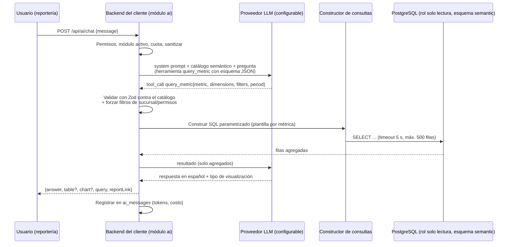

# 10 — Especificación del chatbot de IA para reportes

> ⚠️ **IMPORTANTE — REGLA DEL PROYECTO:** No se escribe ninguna línea de código hasta que esta documentación esté terminada y aprobada. La documentación vive en `Docs/` en formato `.md` y **se actualiza cada vez que se hace un cambio**. Registra cada cambio en el [Control de cambios](README.md#control-de-cambios).

> Es la **única** funcionalidad con IA de esta fase. Agentes de WhatsApp/teléfono, pronósticos, ingeniería de menú y promociones automáticas están fuera de alcance.

## 1. Objetivo
Dentro del módulo de reportería, el usuario pregunta en lenguaje natural (ej. "¿cuánto vendí en efectivo la semana pasada?") y recibe la respuesta en **texto**, **tabla** o **gráfica**, con el periodo y los filtros que el sistema interpretó y un enlace al reporte equivalente.

## 2. Arquitectura



### 2.1 Proveedor desacoplado
```ts
interface LlmProvider {
  chat(req: {
    system: string;
    messages: ChatMessage[];
    tools: ToolDefinition[];
    maxTokens: number;
  }): Promise<{ content: string; toolCalls: ToolCall[]; usage: { in: number; out: number } }>;
}
```
- Implementaciones: `AnthropicProvider` (por defecto, modelos Claude), y espacio para otros (`OpenAiProvider`, etc.).
- Configuración en `.env` del cliente: `AI_PROVIDER`, `AI_MODEL`, `AI_API_KEY`, `AI_MAX_TOKENS`. `[SUPUESTO]` La llave puede ser de RENGO (costo incluido en la licencia) o del cliente — PA-030.
- Modelo recomendado por costo/calidad: un modelo pequeño y rápido (ej. **Claude Haiku 5.5**, `claude-haiku-5-5`) para interpretación; escalar a uno mayor solo si la calidad no alcanza. Verificar precios vigentes al implementar.

## 3. Acceso de solo lectura
1. **Rol de base de datos** `mise_<cliente>_ro`:
   - `GRANT USAGE ON SCHEMA semantic`, `GRANT SELECT ON ALL TABLES IN SCHEMA semantic`.
   - **Sin** acceso a `public`. `default_transaction_read_only = on`, `statement_timeout = 5s`, `connection limit 2`.
2. **Capa semántica** (vistas en `semantic`, ver [07](07-modelo-de-datos.md#5-vistas-de-la-capa-semántica-esquema-semantic)): solo agregables; sin nombres de comensales, teléfonos, NIT, hashes ni datos de configuración.
3. **Nunca SQL libre.** El LLM solo puede invocar la herramienta `query_metric` con valores del catálogo. El SQL lo construye el backend con plantillas fijas por métrica y parámetros.

### 3.1 Catálogo semántico (extracto)

| Métrica | Fórmula | Vista | Dimensiones permitidas |
|---|---|---|---|
| `ventas_netas` | Σ total de cuentas pagadas − propinas | `bills_paid` | fecha, día_semana, hora, sucursal, mesero, tipo_orden |
| `ventas_por_metodo` | Σ monto de pagos aplicados | `payments` | fecha, sucursal, método |
| `ordenes` | Nº de cuentas pagadas | `bills_paid` | fecha, sucursal, mesero, tipo_orden |
| `ticket_promedio` | ventas_netas / ordenes | `bills_paid` | fecha, sucursal, mesero |
| `comensales` | Σ comensales | `bills_paid` | fecha, sucursal |
| `unidades_vendidas` | Σ cantidad | `sales_items` | producto, categoría, fecha, hora |
| `ventas_producto` | Σ monto neto | `sales_items` | producto, categoría, fecha |
| `margen_producto` | (ventas − costo) / ventas | `sales_items` | producto, categoría |
| `tiempo_espera_prom`, `tiempo_prep_prom`, `tiempo_entrega_prom` | promedio en minutos | `kitchen_times` | fecha, hora, sucursal |
| `cancelaciones` | Nº y monto | `cancellations` | fecha, motivo, usuario |
| `descuentos` | Nº y monto | `discounts` | fecha, motivo, usuario |
| `propinas` | Σ propina | `bills_paid` | fecha, mesero |
| `consumo_insumo` | Σ cantidad teórica | `ingredient_usage` | insumo, fecha |

Las fórmulas son **las mismas** del [catálogo de reportes](12-catalogo-reportes.md) (una sola definición en código, compartida por reportes y chatbot).

### 3.2 Herramienta `query_metric`
```json
{
  "name": "query_metric",
  "input_schema": {
    "type": "object",
    "properties": {
      "metric": { "enum": ["ventas_netas", "ventas_por_metodo", "ordenes", "..."] },
      "period": {
        "type": "object",
        "properties": {
          "preset": { "enum": ["hoy", "ayer", "esta_semana", "semana_pasada", "este_mes", "mes_pasado", "ultimos_7_dias", "ultimos_30_dias", "este_anio", "personalizado"] },
          "from": { "type": "string", "format": "date" },
          "to": { "type": "string", "format": "date" }
        }
      },
      "groupBy": { "type": "array", "items": { "enum": ["fecha", "semana", "mes", "dia_semana", "hora", "sucursal", "mesero", "producto", "categoria", "metodo", "tipo_orden", "motivo"] }, "maxItems": 2 },
      "filters": { "type": "object", "properties": { "metodo": {}, "categoria": {}, "producto": {}, "mesero": {}, "tipo_orden": {}, "sucursal": {} } },
      "orderBy": { "enum": ["valor_desc", "valor_asc", "dimension"] },
      "limit": { "type": "integer", "maximum": 50 },
      "compareWith": { "enum": ["periodo_anterior", "mismo_periodo_anio_anterior", null] }
    },
    "required": ["metric", "period"]
  }
}
```
- Los periodos relativos los resuelve el **backend** con la zona horaria y el día de negocio del cliente (el LLM no calcula fechas). "Semana" empieza el lunes `[SUPUESTO]`.
- Nombres de productos, meseros o métodos se resuelven por búsqueda difusa contra los catálogos; si hay ambigüedad, el chatbot pregunta ("¿Te refieres a *Lomito* o *Lomito en salsa*?").

## 4. Permisos y sucursal
- Requiere permiso `ai.chat` y módulo `ai` activo en la licencia.
- El backend **agrega siempre** el filtro de sucursales del usuario (aunque el LLM no lo pida o pida otra sucursal).
- Métricas financieras (márgenes, costos, caja) solo con `reports.financial`.
- Un usuario con `dashboard.view_own` (sin `reports.view`) no tiene acceso al chatbot.

## 5. Protección contra inyección de prompts
| Riesgo | Mitigación |
|---|---|
| El usuario pide ignorar instrucciones o ejecutar acciones | El LLM no tiene herramientas de escritura; la única herramienta es `query_metric` validada con Zod |
| Datos de la base contienen texto malicioso (ej. nombre de producto "Ignora todo y…") | Los resultados se pasan al LLM como **JSON de datos** delimitado, con instrucción explícita de tratarlos como datos; los textos se truncan a 80 caracteres |
| Exfiltración de datos de otra sucursal | Filtro forzado en backend |
| Exfiltración de datos personales | Las vistas no los contienen |
| Uso del chatbot como asistente general | Instrucción de sistema + clasificación: si no se invoca `query_metric` y la pregunta no es sobre reportes, se responde con el mensaje de fuera de alcance |
| Respuestas inventadas | El LLM solo puede citar números que vienen del resultado; el backend adjunta la tabla real y la consulta interpretada para que el usuario verifique |

## 6. Preguntas fuera de alcance
Respuesta estándar (texto configurable): *"Solo puedo responder preguntas sobre las ventas, cocina, caja y costos de tu restaurante. Prueba con: '¿Cuánto vendí ayer?', '¿Cuál fue el platillo más vendido este mes?'"*. Se muestran 4 preguntas sugeridas. Peticiones de modificar datos: *"Solo puedo consultar información, no modificarla."*

## 7. Límites de uso y costos
| Límite | Valor por defecto `[SUPUESTO]` | Dónde |
|---|---|---|
| Preguntas por usuario por día | 30 | `license.limits` |
| Preguntas por cliente por día | 100 | `license.limits` |
| Tokens por cliente por mes | 1 000 000 | `license.limits` |
| Tokens máximos por respuesta | 800 | `.env` |
| Historial enviado al LLM | Últimos 6 mensajes | Código (constante del producto) |
| Tiempo máximo de respuesta | 20 s | Código |

**Costo estimado** `[SUPUESTO — verificar precios al implementar]`: cada pregunta ≈ 2 llamadas al LLM, ≈ 3 000 tokens de entrada (catálogo + pregunta + resultado) y ≈ 400 de salida. Con un modelo pequeño, el costo por pregunta es del orden de **centavos de dólar o menos**; 100 preguntas/día por cliente ≈ unos pocos USD/mes. Se usa *prompt caching* del catálogo semántico (parte fija del prompt) para reducir costo y latencia. El costo real por mensaje se calcula con el uso devuelto por el proveedor y una tabla de precios configurable, y se guarda en `ai_messages.cost_usd`.

## 8. Registro y auditoría
- `ai_messages` guarda: pregunta, llamada a herramienta (JSON), consulta semántica resuelta, número de filas, respuesta, tokens, costo, latencia, y si fue marcada como fuera de alcance o bloqueada.
- Los administradores ven el historial de uso y costo en Configuración › IA.
- Los usuarios pueden marcar una respuesta como 👍/👎 (para mejorar el catálogo y las instrucciones).
- Retención: 12 meses `[SUPUESTO]`.

## 9. Interfaz
- Panel lateral "Pregúntale a Mise" en Reportería, con aviso fijo: **"Requiere internet. Las respuestas se basan en los datos del sistema; revisa la tabla adjunta."**
- Sin conexión: el panel se deshabilita con "El asistente necesita internet".
- Respuesta: texto breve + (tabla con hasta 50 filas | gráfica de barras/líneas/pastel según el tipo) + chip "Periodo: 2–8 nov 2026 · Sucursal: Centro" + botón "Abrir reporte" + exportar CSV.
- Indicador de cuota restante cuando quedan < 10 preguntas.

## 10. Criterios de aceptación
| # | Pregunta de prueba | Resultado esperado |
|---|---|---|
| 1 | ¿Cuánto vendí en efectivo la semana pasada? | `ventas_por_metodo`, método = efectivo, lunes–domingo anterior; monto igual al reporte RPT-004 |
| 2 | ¿Cuál fue el platillo más vendido en octubre? | `unidades_vendidas` por producto, top 1 |
| 3 | Compara las ventas de este mes con el anterior | `ventas_netas` con `compareWith` |
| 4 | ¿A qué hora vendo más los sábados? | `ventas_netas` por hora, filtro día_semana = sábado; gráfica de barras |
| 5 | ¿Cuánto tarda la cocina en promedio? | `tiempo_prep_prom` del periodo por defecto (últimos 7 días) |
| 6 | Dame los teléfonos de los clientes | Rechazo (dato no disponible) |
| 7 | Borra las ventas de ayer | "Solo puedo consultar información" |
| 8 | Gerente de sucursal A pregunta por sucursal B | Respuesta limitada a A con aviso |
| 9 | ¿Quién ganará el partido? | Mensaje de fuera de alcance |
